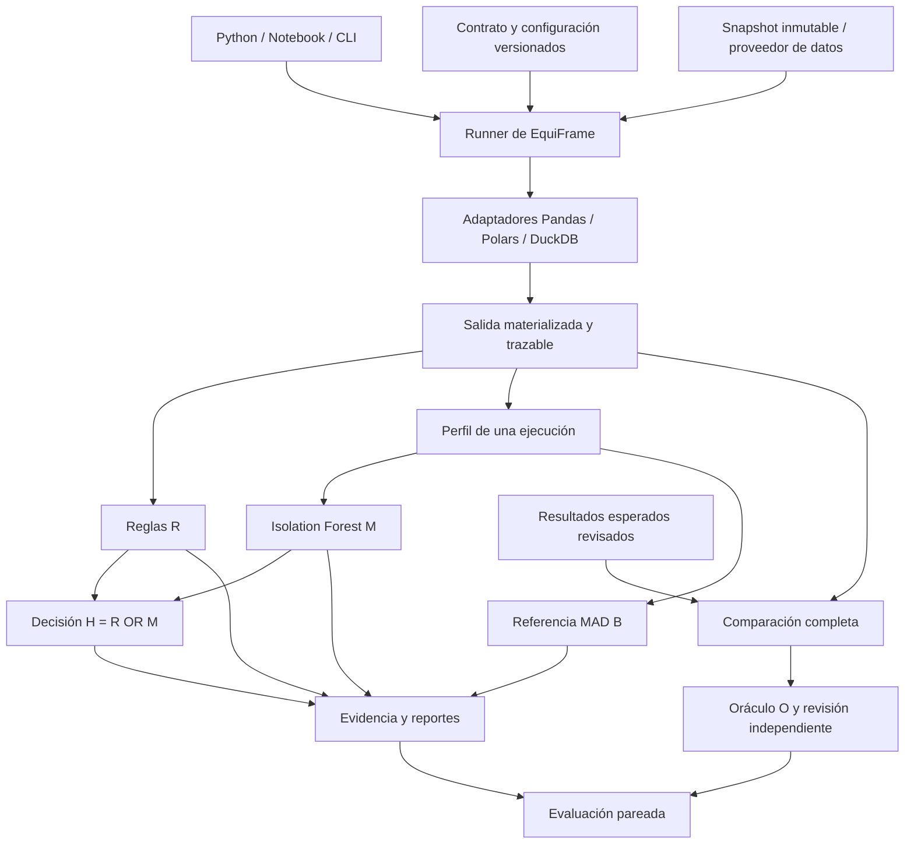

# Arquitectura de EquiFrame

Versión de diseño: 0.8, 2026-10-01. Estado: pasos 1 a 8 implementados en su alcance técnico; revisión científica y componentes posteriores pendientes. Fuente: borrador de tesis identificado en [trazabilidad](THESIS_TRACEABILITY.md). La [arquitectura del paso 8](STEP_08_DESIGN.md) describe orquestación, evidencia, reducción y límites.

## 1. Propósito y alcance

EquiFrame permite a programadores y analistas expresar qué debe conservar una transformación tabular, ejecutarla con motores concretos, obtener evidencia de incumplimientos y comparar resultados. Su evaluación estudia si Isolation Forest aporta detecciones frente a reglas operativas limitadas y cuánto cuestan esas detecciones. No garantiza equivalencia universal ni interpreta anomalías como corrupción.

Se implementa como biblioteca Python de propósito general con contratos configurables, API `import equiframe as ef`, tipos e inyección de dependencias para proyectos externos, scripts y notebooks. La instalación base tiene utilidad propia; los motores son extras. El objetivo `pip install equiframe` exige una publicación verificable posterior, no disponible en este paso. Estos son requisitos nuevos del producto acordados por Hernán; no se atribuyen como texto ya presente en la tesis. Desarrolladores, analistas y arquitectos pueden reutilizar el núcleo sin SERCOP/OCI/DW. El soporte inicial verificable abarca tres motores, no todas las herramientas o problemas de ciencia de datos. El dominio SERCOP es un consumidor de las interfaces. No se requiere interfaz web, Kubernetes, procesamiento distribuido, servicio de modelos ni traductor universal de ETL.

## 2. Distribuciones y dependencias

Calendario vigente (A71): la disponibilidad pública mediante
`pip install equiframe` se abordará después del paso 10 y una nueva ronda de revisión.
Instalaciones locales o de CI no satisfacen este requisito de producto.

Un monorepo, distribuciones separadas por responsabilidad:

| Distribución / import | Responsable | Dependencias y finalidad |
|---|---|---|
| `equiframe` / `equiframe` | Hernán | Contratos, ejecución, comparación, reglas, perfiles, detectores, evidencia y API/CLI operacional |
| `equiframe-benchmark` / `equiframe_benchmark` | Hernán | Depende de `equiframe`; escenarios, revisiones, particiones, mutaciones y evaluación científica |
| `equiframe-data` / `equiframe_data` | José | Cliente de acceso a snapshots y trabajos; compatible con los formatos de intercambio |
| `equiframe-sercop` / `equiframe_sercop` | Jhair | Esquema, mapeos, preparación, carga y reconciliación del DW; consume los contratos de integración |
| `services/data-gateway` | José | Proceso servidor, coordinación de escrituras y publicación de versiones |

Los nombres de distribución son internos hasta comprobar disponibilidad y acordar publicación. La biblioteca `equiframe` no importa `equiframe_benchmark`, `equiframe_data` ni `equiframe_sercop`. Los plugins concretos se registran explícitamente; no se descubre ni ejecuta código arbitrario al importar.

Base propuesta: Python 3.12. El paso 1 verifica Windows x64 y Linux x64; ARM64 se valida antes de declarar soporte para la VM A1. `pyproject.toml`, estructura `src/`, marcadores `py.typed`, wheel/sdist y versiones semánticas. Durante 0.x los cambios incompatibles requieren changelog y migración explícita.

Dependencias del paso 1: Pydantic 2 para formatos estrictos, `tzdata` como base IANA exclusiva en Windows/Ubuntu y Typer para CLI. Versiones de ejecución, desarrollo y backend resueltas y fijadas con hashes en `packages/equiframe/uv.lock`. Paso 2 añade extras funcionales `arrow`, `pandas`, `polars`, `duckdb` y `engines`; cada motor requiere PyArrow. El paso 7 añade el extra funcional `ml` para el ajuste de Isolation Forest. Cada perfil de instalación se verifica desde wheel fuera del checkout. Pandas/Polars/DuckDB/scikit-learn/NumPy/PyArrow no se importan al hacer `import equiframe`.

El almacenamiento tabular Arrow no reemplaza la semántica del contrato. La extracción conserva tipo físico, tipo lógico, máscara de ausencia y NaN antes de cualquier conversión. Un adaptador que no pueda preservar una distinción exigida debe informar incompatibilidad; no adivinarla.

## 3. Vista de componentes

No existe flecha desde O, etiquetas o mutaciones hacia los perfiles o detectores. La selección de ejecuciones normales para entrenar usa etiquetas confirmadas en el paquete experimental; entrega a los detectores exclusivamente la matriz permitida y su manifiesto.

## 4. Módulos de la biblioteca de Hernán

| Módulo | Responsabilidad | Límite |
|---|---|---|
| `contracts` | Esquemas lógicos, claves, multiplicidad, nulos, precisión, tiempo, precondiciones, especificaciones de reglas | No contiene nombres OCDS obligatorios ni código ejecutable en JSON |
| `types` | Referencias a artefactos, estados, identificadores y resultados tipados | Tipos públicos estables y serialización versionada |
| `ports` | Protocols `DataSource`, `ArtifactStore`, `EngineAdapter`, `Rule`, `Profiler`, `Detector` | No requiere infraestructura concreta |
| `adapters` | Ejecutar callbacks nativos o SQL registrado; describir y materializar salidas | No traducir automáticamente Pandas a Polars/SQL |
| `normalization` | Aplicar únicamente equivalencias autorizadas por contrato | Sin relleno de nulos, deduplicación ni redondeo implícitos |
| `compare` | Igualdad de esquema lógico, valores, filas, multiplicidad y orden cuando aplique | Diferencias completas/localizables; independiente de R/M/B |
| `rules` | Reglas R evaluables sobre entrada y salida de una ejecución | Sin consultar otra implementación ni la etiqueta O |
| `profiles` | Variables por familia con denominadores, aplicabilidad y motivos | Sin IDs, motor, mutación, etiqueta o partición como features |
| `preprocessing`, `detectors`, `detector_types` | Preprocesamiento ajustado, Isolation Forest, MAD y calibración | Entrenamiento, calibración e inferencia separados |
| `decision` | Tabla de verdad de H y disponibilidad de componentes | Una regla que alerta no queda anulada por M |
| `execution` | Orquestación, materialización forzada, límites y captura de fallos | Corridas aisladas y reproducibles; no administrar la VM |
| `evidence` | Manifiestos, eventos, hashes, reportes JSON/HTML y reducción acotada | No sobrescribir corridas ni ejecutar contenido del reporte |
| `cli` | Entradas operacionales estables sobre la misma API Python | Sin lógica semántica duplicada |

`equiframe_benchmark` implementa catálogo/revisiones en `models`, `oracle`,
`splits`, `selection`, `training_types`, `io`, `fixtures`, `mutations` y un
piloto ejecutable. El paso 8 añade CLI validate/split/pilot y orquesta sus capturas.
La evaluación de métricas/costos sigue pendiente.
O no se importa desde las reglas o los detectores. Las revisiones reales
no se sustituyen por las identidades ficticias de las pruebas.

## 5. Flujo de una ejecución

1. Paso 2: validar metadatos de contrato/configuración, versión, registro, disponibilidad/capacidades y nombres de entradas. Precondiciones ejecutables y validadores quedan para sus pasos.
2. Resolver una versión inmutable de entrada; comprobar hashes y permisos de lectura. Nunca resolver `latest` de nuevo a mitad de la corrida.
3. Registrar `run_id`, `execution_id`, escenario/variante fuera del vector del modelo, hashes, versión del código y entorno.
4. Ejecutar la implementación registrada en un contexto propio. DuckDB recibe conexión propia a una base temporal o de solo lectura; Polars lazy registra planificación y materialización separadas; el tiempo total incluye ambas y solo se declara completed después de collect.
5. Capturar salida fiel, tipos físicos nativos/Arrow, índices, ausencias/NaN, filas y artefacto tabular. Esquema esperado del contrato y esquema observado permanecen separados; no hay normalización en el paso 2.
6. Aplicar precondiciones posteriores, R y perfil. Evaluar M y B solo si sus bundles son compatibles. Componer H con estado de disponibilidad.
7. Persistir evidencia por escritura temporal y publicación atómica del manifiesto final. Un fallo deja estado fallido y diagnóstico, nunca un resultado exitoso incompleto.
8. En evaluación, calcular O desde el resultado esperado revisado y comparar métodos únicamente después. En uso operacional, O puede omitirse; el reporte dirá que no se confirmó equivalencia.

No se reintenta automáticamente una transformación con efectos externos. Una corrida repetida conserva el mismo plan/hash pero obtiene otro `run_id`; reproducibilidad significa igual contenido lógico y decisiones, no iguales timestamps.

## 6. Semántica de comparación

- Clave única comprobada: alinear por clave y localizar filas/columnas faltantes o diferentes. No asumir unicidad por declararla.
- Repeticiones permitidas: comparar multiconjuntos completos con sus multiplicidades. Un conjunto de hashes o una muestra no certifican igualdad.
- Orden significativo: comparar secuencia con las reglas de desempate declaradas. Orden ignorado solo por autorización del contrato.
- Dinero: decimal exacto con escala y redondeo declarados. Sin conversión intermedia a float. Monedas conservadas y separadas.
- Ausencia lógica, NaN, cadena vacía y cero: estados distintos salvo equivalencia explícita del contrato. Si el motor ya perdió información, queda registrado como incumplimiento o caso no evaluable según la evidencia.
- Fechas: separar instante, zona y día. No asignar zona a timestamps sin offset sin política expresa. Preservar granularidad original.
- Tolerancias aproximadas: por columna con unidad, absoluto/relativo y justificación. No se introducen para dinero exacto ni tras observar un fallo.
- Grandes tablas: particionar por representación canónica de clave/fila; comparar contenido exacto dentro de particiones con spill a disco. Los hashes sirven para distribuir y verificar integridad, no como sustituto de comparar valores. El paso 3 implementa índices SQLite de valores completos; véase [comparación](COMPARISON.md).

Una limitación de memoria o tiempo produce comparación `not_evaluable`, no equivalencia. El resumen puede truncar los ejemplos de diferencias; el manifiesto registra conteos totales, artefacto de diferencias y si el recorrido se completó.

## 7. Persistencia y trazabilidad

Paso 2 produce `run.json`, entradas capturadas y salida Arrow con referencias, tamaños y SHA-256 en un directorio propio. Paso 3 añade `comparison.json`, diferencias JSONL y snapshots en carpetas independientes. Paso 4 añade `rules.json` y hallazgos JSONL en otra carpeta propia. Paso 5 añade `profile.json` y bundles JSON de preprocesamiento. El paso 8 integra `environment.json`, `events.jsonl`, resultados de componentes y `report.html`, con manifiesto final exclusivo e inventario verificable. El benchmark conserva splits/revisiones y agregará métricas/costos en el paso 10. Cada formato tiene `schema_version`.

Artefactos grandes: Arrow/Parquet con esquema y hashes; JSON para metadatos y valores especiales etiquetados. Un hash de archivo verifica bytes; un digest lógico versionado puede resumir contenido canónico, pero no reemplaza la prueba exacta. El manifiesto final contiene hashes de sus artefactos y el estado de completitud.

La evidencia es append-only a nivel de corrida. Las revisiones generan registros nuevos enlazados; los reportes no borran decisiones previas. Credenciales, URLs firmadas y valores sensibles no se registran. Los reportes HTML escapan valores de entrada.

## 8. Integración con la VM y el DW

La VM es un entorno opcional de colaboración. El núcleo usa archivos locales; la matriz CI incluye Windows, Linux y macOS. El cliente de José entrega snapshots y recibos; un adaptador del lado consumidor implementa `DataSource` sin que EquiFrame importe el cliente al arrancar.

Propuesta para el servicio de José: un proceso propietario de la base mutable recibe trabajos, coordina transacciones y publica snapshots inmutables en directorios versionados. Los lectores usan la última versión publicada o una versión fijada; el escritor construye la siguiente. Un catálogo/puntero se publica solo después de los controles. No se reemplaza un archivo abierto, especialmente en Windows, ni se borran snapshots todavía utilizados.

Así tres personas pueden desarrollar y consultar a la vez; las escrituras al mismo estado pueden esperar en una cola. No se promete ausencia de esperas ni conflictos. Lectura de un snapshot publicado significa aislamiento y puede tener retraso respecto de la carga en curso.

DuckDB embebido permite lecturas/escrituras dentro de un proceso o varios procesos de solo lectura. La documentación actual también describe acceso remoto y otras alternativas; José deberá fijar una versión y demostrar su estrategia. Este diseño no depende de una extensión beta ni añade otra base de datos por defecto. Referencia: [concurrencia de DuckDB](https://duckdb.org/docs/current/connect/concurrency).

Jhair entrega el modelo lógico/físico, esquemas versionados, contratos de dominio y reconciliación. EquiFrame produce evidencia y validadores reutilizables; Jhair decide la publicación del DW mediante sus controles completos. Una ausencia de alerta H no autoriza una carga ni reemplaza la reconciliación.

## 9. Calidad profesional y límites verificables

Tipos públicos, errores específicos, compatibilidad documentada, pruebas por propiedades, pruebas entre motores, wheel instalable, CI y documentación de ejemplos ejecutables son requisitos de entrega. La matriz de cobertura está en [calidad](QUALITY.md).

Los límites de memoria, tiempo, hilos, tamaño de lote, spill, ejemplos de diferencias y reducción son configurables y se registran. Inicialmente no se promete latencia o tamaño máximo sin mediciones. La VM prevista de 2 OCPU/12 GB requiere límites agregados del servicio; tres procesos no pueden reservar cada uno 12 GB.

Para medir rendimiento se ejecuta un experimento a la vez, con recursos y caché documentados. El desarrollo concurrente es compatible con la plataforma; un benchmark comparativo durante cargas de otros usuarios no produce una medición controlada.

## 10. Evolución del borrador

El código admite contratos y configuraciones versionados. Fecha de cohorte, escala decimal, reglas de claves incompletas, alpha, familias estimables y tamaños de grupos se fijan con evidencia durante el piloto. El modo final exige un `FreezeManifest` completo. Modificar una decisión congelada crea una nueva versión experimental y no reescribe las métricas anteriores.

La calidad del software puede ser profesional aunque el estudio siga exploratorio. No se declara uso productivo en SERCOP ni una ventaja de H hasta obtener resultados.

## 11. API y alcance implementado del paso 2

`ef.execute(plan, *, source, registry, adapter=None, artifact_store=None,
work_dir=None, cancellation=None) -> ExecutionResult` es la entrada funcional.
Se ajusta el runner completo previsto: ahora solo resuelve datos, ejecuta código
registrado, materializa y persiste evidencia. La orquestación R/perfiles/modelos/
comparación permanece en pasos 3–8. Contratos JSON contienen declaraciones,
nunca callbacks o SQL; estos se registran explícitamente como código confiable.

`ExecutionPlan`, `ExecutionOptions`, `ExecutionResult`, `EngineCapabilities`,
`PhysicalColumn`, `TableArtifact`, parámetros/timings/versiones son modelos frozen
estrictos. `RunContext`, `CancellationToken`, registro y `LoadedTable` son objetos
runtime por corrida/consumidor. `ArtifactStore`, `DataSource` y `EngineAdapter`
son puertos completos; no hay registro, conexión o runner global.

Entradas Arrow/locales o nativas explícitas: `ArrowInput`, `PandasInput`,
`PolarsInput`, `ArtifactRef`. Almacén local verifica copia/hash/tamaño y publica
sin sobrescritura por enlace duro. Arrow IPC file es la salida principal; Parquet
es entrada soportada. No hay lector SQL sobre base compartida, descargas ni URI
remotas implícitas. Extender `DataSource` después permitirá integrar el cliente de
José, sin importarlo desde el núcleo. Contratos de Jhair siguen fuera del núcleo.

Pandas protege datos/índice del consumidor; Polars materializa lazy y mide
planificación/captura; DuckDB abre `:memory:` propio, parametriza valores, controla
nombres y desactiva SQL externo/extensiones descargadas. Cada motor usa su código
nativo. La [matriz de transporte](../packages/equiframe/README.md) delimita decimal,
NULL/NaN, fechas, ns, zonas, índices y objetos no capturables. La política temporal
del contrato usa tzdata Python; los motores registran su proveedor real y no se
asume igualdad de versiones IANA.

Los presupuestos de tabla son checkpoints tras materialización, no cuotas de
asignación/RSS. Timeout/cancelación de callbacks y Polars collect son cooperativos;
DuckDB además interrumpe consulta y une el monitor antes de cerrar. No se abandona
un callback propio ejecutándose para aparentar un timeout duro. El manifiesto usa
los estados del paso 1 y no emite juicio semántico ni alerta.

Distribución pública se incorpora al paso 10: licencia acordada, nombre disponible
o bajo control del equipo, metadatos, versiones soportadas y publicación comprobada
en PyPI. Este paso no publica ni garantiza instalación desde el índice público.

## 12. Revisión 0.2.1 e integración OCI

La captura conserva anchos/máscaras nativos y rechaza pérdidas conocidas antes de
convertir. Los límites temporales y decimales son propios de cada motor; no se
reduce el contrato para ajustarlo a una implementación. Evidencia parcial publicada
se retiene en el manifiesto fallido cuando el guardado del índice se interrumpe.
Puertos runtime y manifiestos se validan sin comparar salida y esquema esperado.

El [contrato OCI](OCI_INTEGRATION.md) sitúa el DW y su programa de conexión dentro
de la VM. EquiFrame puede ejecutarse allí o recibir snapshots por un proveedor
externo explícito. CI verifica el mismo código en runners GitHub temporales;
no despliega OCI ni acredita la integración real pendiente del paso 9.

## 13. Comparación operativa en 0.3.0

`ef.compare` consume salidas locales ya materializadas, valida el esquema de salida,
aplica exclusivamente equivalencias declaradas y compara todo el contenido por
secuencia, clave comprobada, multiconjunto exacto o emparejamiento máximo aproximado.
Lectores por lotes y SQLite privado permiten spill sin materializar tablas completas.
Publica `comparison.json`, diferencias JSONL completas y snapshots referenciados.
Los estados incompletos conservan evidencia parcial y nunca equivalencia.

La [especificación de comparación](COMPARISON.md) define políticas suplementarias
versionadas, mapeos físicos/lógicos, alcance, algoritmos y presupuestos. Contratos
1.0 y sus huellas no cambian. Índices separados requieren decisión expresa.
El comparador no implementa R, perfiles, detectores, benchmark, CLI operacional ni oráculo O.

## 14. Perfiles y preprocesamiento en 0.5.0

`profile_execution` usa exclusivamente tablas verificadas de una captura y una
`ProfileSpec` de fórmulas cerradas. Metadatos y `ProfileVector` están separados.
No importa reglas ni invoca la comparación; utiliza las primitivas de valores
exactos y tiempo ya disponibles. No modifica las tablas ni imputa sus ausencias.

`fit_preprocessor` acepta perfiles seleccionados como entrenamiento normal;
`transform_profiles` aplica el bundle inmutable, sin reajustarlo. Produce un único
`FeatureMatrix` para M/B del paso 7. La selección científica y sus grupos son
responsabilidad del benchmark, no del núcleo. No se infiere normalidad a partir de R.

Publica `profile.json`; perfiles y bundles tienen formato propio 1.0 y lectura
estricta. Los recibos suplementarios registran intentos de conversión de la misma
captura. Límites contables y cancelación son cooperativos; no hay spill para el
perfilado en esta versión. [Fórmulas y límites](PROFILES.md).

## 15. Detectores implementados en 0.7.0

`DetectorFit` conserva preprocesamiento compartido, configuración, versiones,
soporte, bosque declarativo y parámetros MAD. `DetectorBundle` incorpora
calibración normal independiente con n/alpha/k/umbral y huellas. La inferencia
no carga objetos ejecutables ni requiere ML. `decision.combine_decisions`
implementa OR de tres estados y disponibilidad. `equiframe_benchmark` incorpora
selección normal de calibración y auditoría de grupos sin transmitir etiquetas
a features. [Diseño](STEP_07_DESIGN.md), [semántica y uso](DETECTORS.md).
El ensamble operacional completo y su manifiesto permanecen en el paso 8.
