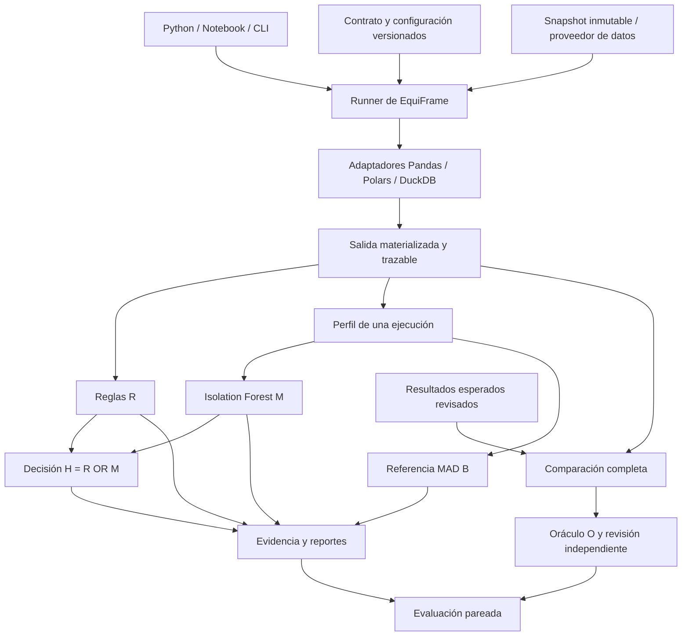

# Arquitectura de EquiFrame

Versión de diseño: 0.1, 2026-09-28. Estado: paso 1 implementado; componentes de pasos posteriores siguen siendo especificación. Fuente: borrador de tesis identificado en [trazabilidad](THESIS_TRACEABILITY.md).

## 1. Propósito y alcance

EquiFrame permite a programadores y analistas expresar qué debe conservar una transformación tabular, ejecutarla con motores concretos, obtener evidencia de incumplimientos y comparar resultados. Su evaluación estudia si Isolation Forest aporta detecciones frente a reglas operativas limitadas y cuánto cuestan esas detecciones. No garantiza equivalencia universal ni interpreta anomalías como corrupción.

Se diseña como biblioteca Python tipada, importable desde scripts y notebooks, con CLI reproducible. El dominio SERCOP es un consumidor de las interfaces. No se requiere interfaz web, Kubernetes, procesamiento distribuido, servicio de modelos ni traductor universal de ETL.

## 2. Distribuciones y dependencias

Un monorepo, distribuciones separadas por responsabilidad:

| Distribución / import | Responsable | Dependencias y finalidad |
|---|---|---|
| `equiframe` / `equiframe` | Hernán | Contratos, ejecución, comparación, reglas, perfiles, detectores, evidencia y API/CLI operacional |
| `equiframe-benchmark` / `equiframe_benchmark` | Hernán | Depende de `equiframe`; escenarios, revisiones, particiones, mutaciones y evaluación científica |
| `equiframe-data` / `equiframe_data` | José | Cliente de acceso a snapshots y trabajos; compatible con los formatos de intercambio |
| `equiframe-sercop` / `equiframe_sercop` | Jhair | Esquema, mapeos, preparación, carga y reconciliación del DW; consume los contratos de integración |
| `services/data-gateway` | José | Proceso servidor, coordinación de escrituras y publicación de versiones |

Los nombres de distribución son internos hasta comprobar disponibilidad y acordar publicación. La biblioteca `equiframe` no importa `equiframe_benchmark`, `equiframe_data` ni `equiframe_sercop`. Los plugins concretos se registran explícitamente; no se descubre ni ejecuta código arbitrario al importar.

Base propuesta: Python 3.12. El paso 1 verifica Windows x64 y Linux x64; ARM64 se valida antes de declarar soporte para la VM A1. `pyproject.toml`, estructura `src/`, marcadores `py.typed`, wheel/sdist y versiones semánticas. Durante 0.x los cambios incompatibles requieren changelog y migración explícita.

Dependencias del paso 1: Pydantic 2 para formatos estrictos, `tzdata` como base IANA exclusiva en Windows/Ubuntu y Typer para CLI. Versiones de ejecución, desarrollo y backend resueltas y fijadas con hashes en `packages/equiframe/uv.lock`. PyArrow y extras `pandas`, `polars`, `duckdb`, `ml`, `all` siguen previstos para los pasos que los utilizan; no se declaran extras vacíos. Pandas/Polars/DuckDB/scikit-learn/NumPy/PyArrow no se importan al hacer `import equiframe`.

El almacenamiento tabular Arrow no reemplaza la semántica del contrato. La extracción conserva tipo físico, tipo lógico, máscara de ausencia y NaN antes de cualquier conversión. Un adaptador que no pueda preservar una distinción exigida debe informar incompatibilidad; no adivinarla.

## 3. Vista de componentes

No existe flecha desde O, etiquetas o mutaciones hacia los perfiles o detectores. La selección de ejecuciones normales para entrenar usa etiquetas confirmadas en el paquete experimental; entrega a los detectores exclusivamente la matriz permitida y su manifiesto.

## 4. Módulos de la biblioteca de Hernán

| Módulo | Responsabilidad | Límite |
|---|---|---|
| `contracts` | Esquemas lógicos, claves, multiplicidad, nulos, precisión, tiempo, precondiciones, especificaciones de reglas | No contiene nombres OCDS obligatorios ni código ejecutable en JSON |
| `types` | Referencias a artefactos, estados, identificadores y resultados tipados | Tipos públicos estables y serialización versionada |
| `ports` | Protocols `DataSource`, `ArtifactStore`, `EngineAdapter`, `Rule`, `Profiler`, `Detector` | No requiere infraestructura concreta |
| `adapters` | Ejecutar callbacks nativos o SQL registrado; describir y materializar salidas | No traducir automáticamente Pandas a Polars/SQL |
| `normalization` | Aplicar únicamente equivalencias autorizadas por contrato | Sin relleno de nulos, deduplicación ni redondeo implícitos |
| `compare` | Igualdad de esquema lógico, valores, filas, multiplicidad y orden cuando aplique | Diferencias completas/localizables; independiente de R/M/B |
| `rules` | Reglas R evaluables sobre entrada y salida de una ejecución | Sin consultar otra implementación ni la etiqueta O |
| `profiles` | Variables por familia con denominadores, aplicabilidad y motivos | Sin IDs, motor, mutación, etiqueta o partición como features |
| `models` | Preprocesamiento ajustado, Isolation Forest, MAD y calibración | Entrenamiento, calibración e inferencia separados |
| `decision` | Tabla de verdad de H y disponibilidad de componentes | Una regla que alerta no queda anulada por M |
| `execution` | Orquestación, materialización forzada, límites y captura de fallos | Corridas aisladas y reproducibles; no administrar la VM |
| `evidence` | Manifiestos, eventos, hashes, reportes JSON/HTML y reducción acotada | No sobrescribir corridas ni ejecutar contenido del reporte |
| `cli` | Entradas operacionales estables sobre la misma API Python | Sin lógica semántica duplicada |

`equiframe_benchmark` añade `catalog`, `oracle`, `reviews`, `provenance`, `splits`, `mutations`, `training`, `evaluation`, `costs` y su CLI. Sus dependencias de desarrollo pueden incluir Hypothesis, SciPy y monitorización de procesos. O no se importa desde `rules` o `models`.

## 5. Flujo de una ejecución

1. Validar contrato, configuración, versión de esquema, disponibilidad del adaptador y precondiciones.
2. Resolver una versión inmutable de entrada; comprobar hashes y permisos de lectura. Nunca resolver `latest` de nuevo a mitad de la corrida.
3. Registrar `run_id`, `execution_id`, escenario/variante fuera del vector del modelo, hashes, versión del código y entorno.
4. Ejecutar la implementación registrada en un contexto propio. DuckDB recibe conexión propia a una base temporal o de solo lectura; Polars lazy se materializa antes de detener el cronómetro de transformación.
5. Capturar salida y métricas de conversión. Registrar esquema físico antes de normalizar, cantidad de filas y artefacto tabular.
6. Aplicar precondiciones posteriores, R y perfil. Evaluar M y B solo si sus bundles son compatibles. Componer H con estado de disponibilidad.
7. Persistir evidencia por escritura temporal y publicación atómica del manifiesto final. Un fallo deja estado fallido y diagnóstico, nunca un resultado exitoso incompleto.
8. En evaluación, calcular O desde el resultado esperado revisado y comparar métodos únicamente después. En uso operacional, O puede omitirse; el reporte dirá que no se confirmó equivalencia.

No se reintenta automáticamente una transformación con efectos externos. Una corrida repetida conserva el mismo plan/hash pero obtiene otro `run_id`; reproducibilidad significa igual contenido lógico y decisiones, no iguales timestamps.

## 6. Semántica de comparación

- Clave única comprobada: alinear por clave y localizar filas/columnas faltantes o diferentes. No asumir unicidad por declararla.
- Repeticiones permitidas: comparar multiconjuntos completos con sus multiplicidades. Un conjunto de hashes o una muestra no certifican igualdad.
- Orden significativo: comparar secuencia con las reglas de desempate declaradas. Orden ignorado solo por autorización del contrato.
- Dinero: decimal exacto con escala y redondeo declarados. Sin conversión intermedia a float. Monedas conservadas y separadas.
- Ausencia lógica, NaN, cadena vacía y cero: estados distintos salvo equivalencia explícita del contrato. Si el motor ya perdió información, queda registrado como incumplimiento o caso no evaluable según la evidencia.
- Fechas: separar instante, zona y día. No asignar zona a timestamps sin offset sin política expresa. Preservar granularidad original.
- Tolerancias aproximadas: por columna con unidad, absoluto/relativo y justificación. No se introducen para dinero exacto ni tras observar un fallo.
- Grandes tablas: particionar por representación canónica de clave/fila; comparar contenido exacto dentro de particiones y permitir spill a disco. Los hashes sirven para distribuir y verificar integridad, no como sustituto de comparar los valores. La estrategia exacta se prueba en el paso 3.

Una limitación de memoria o tiempo produce comparación `not_evaluable`, no equivalencia. El resumen puede truncar los ejemplos de diferencias; el manifiesto registra conteos totales, artefacto de diferencias y si el recorrido se completó.

## 7. Persistencia y trazabilidad

Una corrida produce, según el modo, `run.json`, `environment.json`, `events.jsonl`, `rules.json`, `profile.json`, `decisions.json`, `comparison.json`, `report.html` y referencias a entradas/salidas. El benchmark agrega manifiestos de splits, revisiones, métricas y costos. Cada formato tiene `schema_version`.

Artefactos grandes: Arrow/Parquet con esquema y hashes; JSON para metadatos y valores especiales etiquetados. Un hash de archivo verifica bytes; un digest lógico versionado puede resumir contenido canónico, pero no reemplaza la prueba exacta. El manifiesto final contiene hashes de sus artefactos y el estado de completitud.

La evidencia es append-only a nivel de corrida. Las revisiones generan registros nuevos enlazados; los reportes no borran decisiones previas. Credenciales, URLs firmadas y valores sensibles no se registran. Los reportes HTML escapan valores de entrada.

## 8. Integración con la VM y el DW

La VM es un entorno opcional de colaboración. El núcleo funciona en Windows o Linux con archivos locales. El cliente de José entrega snapshots y recibos; un adaptador del lado consumidor implementa `DataSource` sin que EquiFrame importe el cliente al arrancar.

Propuesta para el servicio de José: un proceso propietario de la base mutable recibe trabajos, coordina transacciones y publica snapshots inmutables en directorios versionados. Los lectores usan la última versión publicada o una versión fijada; el escritor construye la siguiente. Un catálogo/puntero se publica solo después de los controles. No se reemplaza un archivo abierto, especialmente en Windows, ni se borran snapshots todavía utilizados.

Así tres personas pueden desarrollar y consultar a la vez; las escrituras al mismo estado pueden esperar en una cola. No se promete ausencia de esperas ni conflictos. Lectura de un snapshot publicado significa aislamiento y puede tener retraso respecto de la carga en curso.

DuckDB embebido permite lecturas/escrituras dentro de un proceso o varios procesos de solo lectura. La documentación actual también describe acceso remoto y otras alternativas; José deberá fijar una versión y demostrar su estrategia. Este diseño no depende de una extensión beta ni añade otra base de datos por defecto. Referencia: [concurrencia de DuckDB](https://duckdb.org/docs/current/connect/concurrency).

Jhair entrega el modelo lógico/físico, esquemas versionados, contratos de dominio y reconciliación. EquiFrame produce evidencia y validadores reutilizables; Jhair decide la publicación del DW mediante sus controles completos. Una ausencia de alerta H no autoriza una carga ni reemplaza la reconciliación.

## 9. Calidad profesional y límites verificables

Tipos públicos, errores específicos, compatibilidad documentada, pruebas por propiedades, pruebas entre motores, wheel instalable, CI y documentación de ejemplos ejecutables son requisitos de entrega. La matriz de cobertura está en [calidad](QUALITY.md).

Los límites de memoria, tiempo, hilos, tamaño de lote, spill, ejemplos de diferencias y reducción son configurables y se registran. Inicialmente no se promete latencia o tamaño máximo sin mediciones. La VM prevista de 2 OCPU/12 GB requiere límites agregados del servicio; tres procesos no pueden reservar cada uno 12 GB.

Para medir rendimiento se ejecuta un experimento a la vez, con recursos y caché documentados. El desarrollo concurrente es compatible con la plataforma; un benchmark comparativo durante cargas de otros usuarios no produce una medición controlada.

## 10. Evolución del borrador

El código admite contratos y configuraciones versionados. Fecha de cohorte, escala decimal, reglas de claves incompletas, alpha, familias estimables y tamaños de grupos se fijan con evidencia durante el piloto. El modo final exige un `FreezeManifest` completo. Modificar una decisión congelada crea una nueva versión experimental y no reescribe las métricas anteriores.

La calidad del software puede ser profesional aunque el estudio siga exploratorio. No se declara uso productivo en SERCOP ni una ventaja de H hasta obtener resultados.
