# Plan de Hernán: veinte pasos de implementación, calidad y publicación

**Revisión del plan:** 2026-10-01; conciliación con evidencia actual: 2026-10-03. Los pasos 1–10 conservan su alcance; por
instrucción de Hernán se incorporan 11–15 para revisión y validación real, y
16–20 para distribución pública. Esta ampliación es planificación de ingeniería:
no acredita ejecución, aprobación científica, integración real ni publicación.

Toda la implementación de este plan se encomienda a Sol. El repositorio inicial solo prepara el diseño. Este plan cubre el trabajo de Hernán; no delega en Sol la VM/conector de José ni la construcción del DW de Jhair. El prompt del paso 1 se entrega en el chat y no se guarda aquí.

Cada paso produce código funcional para su alcance, pruebas significativas, documentación y un cambio revisable. No se crean APIs vacías para anticipar pasos posteriores. Los pasos 1 a 8 funcionan con datos sintéticos/locales; 9 y 10 incorporan las entregas reales del equipo.

En los pasos de revisión, el entregable puede ser evidencia y documentación sin
cambios de código cuando no se encuentren defectos. Los pasos nuevos están
**planificados, con avances acotados documentados abajo**. El estado técnico
de partida era núcleo 0.10.0/benchmark 0.10.1 (pasos 1–10 y migrador); el candidato
de aquella revisión era 0.11.1 para ambos. El candidato actual (2026-10-07)
es 0.12.0a7; la [revisión de usabilidad](USABILITY_PLAN.md) no sustituye
los criterios externos ni las evidencias históricas. Se preservan todos los pasos 11–20 incorporados por
Hernán y la distinción entre ingeniería implementada y cierre científico pendiente.

| Estado de esta entrega | Evidencia y límite |
|---|---|
| Implementado y ejecutado localmente | Verify, ingestión, workflow, IR ampliado, Parquet/bundles, correcciones y reporte pareado descriptivo; [revisión 0.11.1](COMPREHENSIVE_REVIEW_20261003.md), [historia 0.11.0](VERIFY_ETL_REVIEW_20261003.md) |
| Validación real acotada del paso 14 | API SERCOP fijada, tres paquetes/dos awards, seis direcciones y esperado manual; no corpus científico |
| Preparación técnica de 16–18 | Candidatos wheel/sdist, Twine y consumidores limpios; no cierre de licencia/titularidad/aceptación externa |
| Pendiente de insumos externos | DW/OCI del paso 15, corpus efectivo, revisión científica doble/arbitraje, licencia/nombre/acceso público |
| Planificado | Publicación del paso 19 y aceptación pública del 20; no autorizadas por este encargo |

Esta revisión contribuye a 11–13 y 16–18 sin declarar cumplidos sus criterios
humanos, externos o de totalidad. Los informes históricos conservan su fecha y
versión; no se reescribe la historia como si 0.11.0 hubiera existido antes.

| Etapa | Pasos | Resultado exigido |
|---|---|---|
| Implementación y evaluación inicial | 1–10 | Biblioteca, experimento trazable y entrega reproducible |
| Revisión de fallas, calidad y profesionalismo | 11–13 | Defectos tratados, evidencia de regresión y experiencia documentada |
| Dos validaciones reales | 14–15 | Casos SERCOP y conexión demostrada con DW/DuckDB |
| Preparación y publicación pública | 16–20 | Licencia, nombre, distribución probada, PyPI y aceptación externa |

Se conserva A71 de [decisiones](DECISIONS.md): la publicación sucede después del
paso 10 y de una nueva revisión. Este plan concreta esa revisión en 11–15 y sitúa
la publicación en 19. Redactar este roadmap no ejecuta esas etapas ni autoriza
por sí solo una subida a TestPyPI/PyPI o un despliegue.

## Paso 1. Fundaciones Python, contratos y tipos públicos

**Objetivo:** crear una base instalable y estricta, capaz de expresar y validar contratos semánticos sin necesitar la VM.

**Trabajo:** implementar `packages/equiframe` con `pyproject.toml`, estructura `src`, tipado, versiones, errores, modelos inmutables de tipos/contratos y referencias mínimas a artefactos; esquemas JSON generados, políticas explícitas, serialización canónica y validación cruzada. Definir los Protocols de integración que ya puedan expresarse con tipos completos. Añadir un comando real `equiframe contract validate`, entorno aislado, bloqueo reproducible de dependencias de desarrollo y CI Windows/Linux. Crear ejemplos sintéticos de contratos para las cinco familias; no calificarlos como casos científicos revisados.

**Aceptación:** instalar wheel en entorno limpio; importar sin motores/ML; validar ejemplos; rechazar claves inexistentes, esquemas/versiones inválidos, precisión/escala inconsistente, campos desconocidos y coerciones con pérdida. Roundtrip exacto de decimales/tiempo y versiones; hashes estables de metadatos canónicos. Pruebas, tipado, estilo y empaquetado pasan. README contiene comandos realmente ejecutados y soporte comprobado. No ejecutar transformaciones, entrenar modelos ni implementar componentes de compañeros.

## Paso 2. Ejecución y adaptadores nativos

**Objetivo:** ejecutar transformaciones registradas con Pandas, Polars y DuckDB sobre entradas idénticas, como biblioteca general importable mediante `import equiframe as ef` desde otro proyecto.

**Trabajo:** puertos de datos/artefactos locales, registro explícito, `ExecutionPlan/Result`, contexto aislado, capacidades, importación opcional, conversiones fieles y materialización de salidas. Crear transformaciones sintéticas independientes, no conversiones de una salida común. Capturar tiempos/estados y cerrar recursos en fallos. Base útil, extras por motor, intercambio local explícito, salida observada separada del contrato y ejemplos genéricos de dos dominios. Documentar precisión, índices, bases temporales y controles cooperativos/exigibles.

**Aceptación:** cada motor ejecuta código propio; preserva decimal/null/NaN/tiempo o informa incompatibilidad; entradas no se alteran; dos corridas aisladas no mezclan artefactos; fallo, cancelación y ausencia de extra generan diagnóstico verificable. Sin conexiones globales.

## Paso 3. Normalización y comparación exacta

**Estado:** implementación funcional en 0.3.0, con API, pruebas, ejemplos y consumo
del wheel fuera del checkout. [Semántica](COMPARISON.md) y
[verificación de entrega](STEP_03_REVIEW.md). La revisión científica O sigue pendiente.

**Objetivo:** comprobar contenido completo y localizar diferencias autorizando solo equivalencias del contrato.

**Trabajo:** igualdad de esquema, alineación por clave comprobada, comparación de multiconjuntos y secuencias, tolerancias justificadas, decimales, ausencias y tiempo. Estrategia por lotes/particiones con spill y límites; evidencia de diferencias.

**Aceptación:** detecta intercambio de montos conservando total, pérdida de duplicados y cambios de zona; acepta permutaciones solo cuando corresponde; no declara igualdad por hashes/muestra; informa comparación incompleta por recursos. Pruebas por propiedades y esperados independientes cubren las cinco familias.

## Paso 4. Reglas operativas R y catálogo de contratos

**Estado:** implementación de ingeniería 0.4.0 con API, las seis formas de
regla, precondiciones, cobertura, catálogo técnico de cinco familias y pruebas.
[Semántica](RULES.md) e [informe](STEP_04_REVIEW.md). El benchmark revisado y el
congelamiento experimental final permanecen en sus pasos previstos.

**Objetivo:** disponer de una línea base determinista separada del comparador.

**Trabajo:** registro de reglas de esquema, claves, cardinalidad, ausencias, conversiones y reconciliación seleccionada por contrato. Condiciones de aplicabilidad, evidencia observada/esperada y agregación de decisiones. Formalizar contratos de transformaciones antes de generar mutantes finales.

**Aceptación:** R funciona sobre una ejecución sin otro motor/etiquetas; controles correctos difíciles no fallan indebidamente; reglas faltantes/no evaluables no se convierten en éxito; cada alerta localiza causa. Congelar y registrar revisiones de R usadas por el benchmark.

## Paso 5. Perfiles por familia y preprocesamiento

**Estado:** implementación de ingeniería 0.5.0. Diez fórmulas, especificaciones
versionadas, recibos de conversión, soporte y preprocesamiento persistente.
[Semántica](PROFILES.md) e [informe de entrega](STEP_05_REVIEW.md). La selección
científica de columnas y entrenamiento normal debe validarse en los pasos 6/7;
no se presenta el preprocesador como un detector entrenado.

**Objetivo:** producir features reproducibles con denominadores y soporte explícitos.

**Trabajo:** implementar fórmulas de sección 3.6 por columna/familia, indicadores de no aplicabilidad, metadatos separados, orden fijo y preprocesador ajustado solo con entrenamiento normal. Comprobar ausencia de fuga e incompatibilidades de feature version.

**Aceptación:** vacíos/cero/NaN/ausencia se distinguen; denominadores correctos; imputación se mantiene al puntuar; no hay etiquetas, IDs, mutación, motor ni partición dentro de la matriz; M/B reciben exactamente el mismo preprocesamiento. Ningún perfil usa otra salida de motor.

## Paso 6. Oráculo, catálogo y particiones independientes

**Estado:** implementación técnica `equiframe-benchmark 0.6.0`, con oráculo,
paquetes ciegos, validación de revisores, procedencia, splits y selección normal.
[Diseño y reorientación](STEP_06_DESIGN.md), [uso](../packages/equiframe-benchmark/README.md)
e [informe](STEP_06_REVIEW.md). Piloto de 5 escenarios/35 candidatos/15 perfiles,
4 grupos y 35 revisiones pendientes. El cierre científico permanece abierto.

**Objetivo:** disponer de un benchmark trazable antes de ajustar detectores.

**Trabajo:** crear distribución `equiframe-benchmark`; catálogo técnico de cinco familias, resultados esperados independientes, mutaciones candidatas, controles correctos, registro de revisión ciega y estados pendientes. Construir grupos por dependencias transitivas, splits por grupos y validación de fuga. Informar cantidades efectivas por familia/partición conforme al corpus y su revisión; 60 escenarios/300 perfiles son cuotas históricas sustituidas y no metas de la tesis vigente. Desarrollar equivalentes nativos por motor necesarios para los nueve estratos principales.

**Aceptación:** etiquetas no proceden de detectores; mutante sin efecto reconocido; revisores/autores controlados; ningún grupo cruza particiones. Mostrar cantidad real por familia/partición y pendientes, sin inventar aprobaciones. Catálogo técnico puede completarse mientras las revisiones humanas siguen pendientes; el cierre científico requiere esas revisiones.

## Paso 7. Isolation Forest, MAD, calibración e híbrido

**Estado:** ingeniería implementada en núcleo y benchmark 0.7.0. [Diseño y
reorientación](STEP_07_DESIGN.md), [API y límites](DETECTORS.md) e
[informe de verificación](STEP_07_REVIEW.md). Ajuste/calibración/inferencia
separados, selección normal de calibración y auditoría de grupos. El piloto
del paso 6 sigue sin soporte científico; no se declara entrenado un modelo
experimental. La revisión posterior se concreta en los pasos 11–15 y la
distribución pública en 16–20, conforme a la ampliación indicada por Hernán.

**Objetivo:** implementar M, B y H con estados estadísticos y técnicos correctos.

**Trabajo:** ajuste normal por familia, soporte/variación, bundles compatibles, score M con signo definido, MAD y casos MAD=0, cuantiles sin interpolación, alpha explícito y tabla completa H. Persistencia segura y versionada; no entrenar/calibrar con prueba.

**Aceptación:** score igual al restaurar bundle; umbral calculado exactamente; igualdad con umbral no alerta; umbral infinito MAD informa no estimable; nueve combinaciones de H correctas; desajuste de features/versiones rechazado. Alpha y tamaño de calibración no se presentan como garantía empírica sin soporte.

## Paso 8. Orquestación completa, evidencia y CLI

**Objetivo:** ofrecer una experiencia coherente para scripts, notebooks y automatización.

**Trabajo:** integrar ejecución/R/perfil/M/B/H y comparación opcional; manifiestos append-only, logs estructurados, reporte JSON/HTML, códigos de salida y comandos de benchmark. Reductor de casos con presupuesto y preservación de precondiciones/fallo. Documentar ejemplos y API extensible.

**Aceptación:** una corrida se explica desde sus artefactos; errores dejan evidencia sin éxito falso; HTML escapa entradas; secretos excluidos; relanzar no sobrescribe corrida anterior; reducción informa límite y no afirma mínimo global. Ejemplos usan paquetes instalados.

## Paso 9. Integración real con José y Jhair

**Objetivo:** conectar EquiFrame con snapshots y transformaciones reales manteniendo responsabilidades.

**Trabajo de Hernán:** adaptador consumidor del cliente de José, escenarios SERCOP basados en contratos de Jhair, ejecución comparable entre motores y reportes de reconciliación. Probar esquemas/hashes/versiones/cancelación y comparar outputs del DW sin administrar el servicio ni cambiar su modelo unilateralmente.

**Dependencias:** cliente autenticado y snapshots de José; DDL, entradas/salidas/mapeos y reconciliación de Jhair. Si faltan, completar pruebas locales de conformidad y registrar el bloqueo de integración real; no simular que se probó la VM.

**Aceptación:** misma entrada verificable para tres motores; monto único por adjudicación, monedas separadas y claves/fechas según contrato; evidencia real de incompatibilidades; publicación del DW sigue bajo controles de Jhair/José. Se verifica lectura estable durante carga con las pruebas del servicio, no se atribuye esa funcionalidad al núcleo.

## Paso 10. Congelación, evaluación y entrega reproducible

**Objetivo:** entregar software utilizable y evidencia defendible para la tesis.

**Trabajo:** completar la evaluación e inventariar los requisitos para una distribución pública posterior: licencia, control del nombre, metadatos y versiones soportadas. Resolver decisiones metodológicas, congelar manifests, ejecutar R/M/B/H en prueba, métricas pareadas/cobertura, incertidumbre por grupos si procede, costos controlados y tablas regenerables. Medir recursos, revisar API/documentación, construir distribuciones y bundle de reproducción; repetición independiente por compañero. No publicar en PyPI en este paso: primero debe completarse y realizarse la revisión de 11–15; los requisitos de distribución se resuelven en 16–20.

**Aceptación:** cada contraste principal usa el mismo soporte pareado evaluable de sus dos métodos y O confirmado; la intersección común R/M/B/H se informa adicionalmente con cobertura y denominadores. El reporte histórico del paso 10 mantiene su protocolo: adoptar el protocolo principal vigente exige una nueva congelación, sin reinterpretar resultados previos. Métricas indefinidas explícitas; no se ajusta con prueba; resultados negativos se conservan; otro integrante reproduce contenido y decisiones. Wheel/sdist y dependencias exactas comprobados; soporte ARM64 solo si probado. Los capítulos de resultados futuros se redactan con evidencia real; la entrega Word vigente contiene 1–2 y anexos preparatorios. La publicación pública queda pendiente de 11–18 y de la tarea explícita del paso 19.

## Paso 11. Revisión de fallas y correcciones verificables

**Objetivo:** revisar el producto entregado en 1–10 y corregir defectos de
comportamiento antes de ampliar su exposición.

**Entrada y responsables:** entrega identificada por commit/versión y evidencia
del paso 10; Hernán coordina la revisión del núcleo y benchmark.

**Trabajo:**

1. Inventariar API, CLI, contratos, ejecución, comparación, R, perfiles, M/B/H,
   persistencia y evaluación. Contrastar comportamiento observado con contratos;
   incluir las rutas de error, datos límite y estados no evaluables.
2. Registrar cada hallazgo con ID, componente, gravedad, reproducción mínima,
   esperado independiente, observado, impacto y decisión. Separar defecto,
   limitación declarada y mejora; asignar responsable y versión de corrección.
3. Priorizar pérdida de datos, falsa equivalencia, falsa ausencia de alerta,
   fuga entre particiones, corrupción de evidencia y acceso indebido a artefactos.
4. Corregir con regresiones que fallen antes del arreglo y pasen después cuando
   sea técnicamente aplicable. Verificar compatibilidad de formatos y consumidores.
5. Si una corrección afecta el experimento congelado, identificar resultados
   afectados, versionar la revisión y repetir la evaluación necesaria sin borrar
   resultados previos ni ajustar parámetros con la prueba.

**Entregables:** registro de hallazgos, correcciones revisables, regresiones y
reporte de impacto sobre API, formatos y evidencia científica.

**Aceptación:** ningún defecto crítico o alto confirmado permanece abierto en el
alcance que se pretende publicar. El resto tiene disposición explícita y límites
documentados; no basta marcarlo como conocido. Las correcciones tienen evidencia
reproducible y los resultados invalidados quedan identificados.

## Paso 12. Control de calidad, compatibilidad y recursos

**Objetivo:** demostrar que la versión corregida funciona de forma consistente
en los entornos y perfiles de instalación que declara soportar.

**Entrada:** candidato del paso 11, matriz de [calidad](QUALITY.md) y registro de
hallazgos. La configuración de CI se distingue de los jobs realmente completados.

**Trabajo:**

1. Ejecutar controles de estilo, tipado, esquemas, pruebas de comportamiento,
   propiedades y regresiones del núcleo y benchmark contra el mismo commit.
2. Verificar Windows x64, Linux x64/ARM64 y macOS Intel/Apple Silicon según la
   matriz vigente. Python 3.12 es el soporte actual; cada versión nueva necesita
   resolución de dependencias, pruebas e instalación antes de anunciarse.
3. Probar instalación base y extras aislados, combinaciones soportadas, importación
   ligera, uso desde otro proyecto y reconstrucción del wheel desde sdist.
   Registrar versiones efectivas; el lock de desarrollo no fija el entorno de
   todos los consumidores, por lo que se prueban resoluciones de los rangos admitidos.
4. Medir memoria, disco, tiempos y materialización con volúmenes declarados;
   comprobar cancelación, liberación de conexiones/archivos y artefactos parciales.
   Definir presupuestos antes de ejecutar y conservar resultados desfavorables.
5. Revisar aislamiento de corridas, integridad, serialización segura y ausencia
   de secretos en logs/reportes. Ejercitar fallos de I/O y recursos sin ocultarlos
   como éxito ni atribuir límites duros a controles cooperativos.

**Entregables:** matriz entorno × perfil × resultado, comandos/logs de controles,
mediciones con alcance y listado de incompatibilidades o regresiones.

**Aceptación:** cada combinación anunciada tiene evidencia del candidato. Los
casos omitidos o no ejecutables figuran como tales. No hay regresiones sin resolver
en el soporte prometido; no se fijan garantías de rendimiento sin medición.

## Paso 13. Profesionalismo de API, CLI y documentación

**Objetivo:** lograr que otro desarrollador pueda entender, instalar y utilizar
la herramienta, interpretar sus resultados y conocer sus límites.

**Entrada:** candidato de calidad del paso 12 y alcance funcional comprobado.

**Trabajo:**

1. Revisar nombres, firmas, tipos públicos, mensajes de error, códigos de salida,
   compatibilidad y cambios incompatibles. API y CLI deben expresar la misma
   semántica, incluidos estados parciales y no evaluables.
2. Conciliar README, referencia de API, arquitectura, ejemplos y changelog con
   el código. Corregir versiones y frases obsoletas que presentan como pendiente
   una API implementada o como disponible una integración futura.
3. Preparar recorridos ejecutables para contratos, transformación nativa,
   comparación, R, perfiles y uso de detectores compatibles. Explicar instalación
   base/extras, requisitos, evidencia producida y diagnóstico de fallos frecuentes.
4. Separar guía de usuario, desarrollo e investigación. Documentar extensión por
   puertos, migraciones, reporte de errores y mantenimiento; usar datos sintéticos
   publicables en los ejemplos generales.
5. Pedir a un consumidor distinto del autor ejecutar el recorrido desde un
   entorno limpio con las instrucciones escritas. Registrar dificultades y
   corregirlas; esta prueba todavía puede usar el artefacto privado del equipo.

**Entregables:** documentación coherente, ejemplos comprobados, política de
compatibilidad y registro de la revisión de usabilidad.

**Aceptación:** el consumidor completa un caso funcional sin editar `sys.path`,
usar rutas del autor o recibir instrucciones esenciales fuera de la guía.
`completed`, `equivalent`, `no_alert` y resultado científico tienen significados
distintos y explícitos. La calificación profesional se apoya en estos controles,
sin implicar certificación ni uso productivo ya demostrado.

## Paso 14. Validación de comportamiento con casos reales SERCOP

**Objetivo:** verificar la semántica de EquiFrame con un corpus real identificado,
independientemente de la conexión operativa al DW que se verifica en el paso 15.

**Entrada y responsables:** Hernán prepara escenarios/evidencia; Jhair aporta y
valida semántica, mapeos y contratos de dominio; el proveedor entrega extractos
con procedencia y condiciones de uso. Se parte de la integración inicial de 9 y
se vuelve a comprobar el candidato corregido de 11–13.

**Trabajo:**

1. Fijar snapshot, cohorte, reglas de selección, esquema, hashes y procedencia.
   Mantener original, tablas derivadas y exclusiones trazables fuera de Git.
   Justificar tamaño y diversidad a partir de lo recibido, sin inventar cobertura.
2. Construir la matriz de cinco familias genéricas del producto; el estudio
   principal conserva tres familias y tres parejas (nueve estratos). Para cada
   caso definir entrada, contrato, código por motor, esperado
   independiente, revisores y condición de aceptación antes de observar detecciones.
3. Ejecutar Pandas, Polars y DuckDB sobre las mismas entradas de cada etapa,
   conservando precisión, monedas, multiplicidad, ausencias y fechas. Comparar
   contenido completo; un total agregado coincidente no acredita equivalencia.
4. Ejecutar R, perfiles y M/B/H solo con soporte y bundles compatibles. Aplicar el
   procedimiento de modelado de este plan; una familia sin soporte conserva su
   estado no estimable y no recibe un modelo ficticio.
5. Mantener separados datos originales, anomalías observadas y alteraciones
   controladas de copias. Una mutación sobre datos reales sigue siendo un caso
   artificial y puede no causar divergencia; O se revisa independientemente.
6. Informar decisiones, diferencias, cobertura, errores y costos por caso/familia.
   Reportar métricas contra O únicamente donde exista referencia confirmada y
   soporte; una alerta no constituye por sí misma irregularidad de contratación.

**Entregables:** catálogo real versionado, contratos y esperados revisados,
manifiestos de corridas, ficha de modelos y reporte de cobertura/resultados.
Git contiene definiciones publicables y referencias; los datos y bundles reales
permanecen en almacenamiento autorizado.

**Aceptación:** existe evidencia sobre datos SERCOP reales, con revisión y
procedencia verificables. Cada familia tiene casos ejecutados o una ausencia
justificada que limita expresamente las conclusiones. No se cierra con fixtures
sintéticos en sustitución del corpus. Este ensayo posterior no cambia ni mejora
retroactivamente los resultados congelados en 10.

## Paso 15. Verificación real de integración con DW y DuckDB

**Objetivo:** demostrar el recorrido DW → snapshot → EquiFrame → evidencia y la
consistencia de la lectura durante operaciones reales del servicio.

**Entrada y responsables:** casos aceptados de 14; José entrega servicio/cliente
autenticado y coordinación de DuckDB; Jhair entrega DW, DDL, diccionario, carga y
reconciliación. Hernán implementa y verifica el consumidor conforme a
[integración del equipo](TEAM_INTEGRATION.md) e [integración OCI](OCI_INTEGRATION.md).

**Trabajo:**

1. Acordar el modelo lógico/físico y los mapeos según la sección de arquitectura.
   Versionar grano, claves, medidas, relaciones, reglas de carga y excepciones;
   validar las tablas entregadas sin redefinir unilateralmente el DW de Jhair.
2. Conectar el cliente de José a un proveedor externo `DataSource`: fijar un
   snapshot una vez, descargar/materializar referencias verificadas y entregar
   `LoadedTable`. Probar dentro de la VM y desde otro equipo si ambas modalidades
   se ofrecen; documentar cuál se ejecutó realmente.
3. Repetir casos de 14 desde el DW real y reconciliar con fuente/esperados
   independientes: adjudicaciones, proveedores, vínculos, excepciones y montos
   por moneda/estado. No multiplicar montos al recorrer la tabla puente.
4. Comprobar con José tres lectores durante una carga, escrituras coordinadas,
   repetición idempotente, conflicto de versión base, pérdida de respuesta,
   cancelación, caída antes de publicación y recuperación. Una prueba destructiva
   usa copia/entorno de integración, nunca el archivo operativo sin autorización.
5. Verificar hash incorrecto, permisos insuficientes, transporte interrumpido,
   snapshot retirado y diferencias de esquema. No mezclar versiones entre tablas
   ni confundir solicitud de trabajo aceptada con carga publicada.
6. Medir recursos agregados y separar transferencia, extracción y ejecución de
   EquiFrame. Guardar versiones de VM, cliente, DuckDB, DDL y biblioteca; documentar
   recuperación y responsables operativos. H no decide la publicación del DW.

**Entregables:** diagrama validado de integración, mapeos/contratos, consumidor,
procedimiento de ejecución y reporte conjunto con IDs de trabajos y snapshots.

**Aceptación:** lectura real autenticada, snapshot fijo, reconciliación y pruebas
de consistencia/fallos demostradas en el entorno declarado. El motor DuckDB local
del núcleo no se presenta como conexión al DW. Si faltan VM, cliente, datos o DDL,
se registra dependencia pendiente; un mock no cierra este paso. Hallazgos nuevos
vuelven a 11–13 y se repiten los casos afectados antes de avanzar.

## Paso 16. Licencia, nombre y gobierno de la distribución

**Objetivo:** resolver quién puede distribuir el software, bajo qué licencia y
qué cuenta del equipo administrará el nombre público.

**Entrada:** cierre documentado de 11–15 e inventario de autores, componentes y
material redistribuible. Hernán coordina; los titulares deciden la licencia.

**Trabajo:**

1. Revisar autorías, contribuciones y condiciones aplicables del proyecto;
   acordar licencia sin seleccionarla unilateralmente. Separar licencia del código
   de permisos para redistribuir datos SERCOP, documentación y modelos.
2. Incorporar `LICENSE`, avisos necesarios y metadatos SPDX compatibles con el
   backend; comprobar su inclusión en ambos formatos de distribución.
   [Guía de licencias y empaquetado](https://packaging.python.org/en/latest/tutorials/packaging-projects/).
3. Consultar `equiframe` en PyPI y registrar fecha y resultado. Una consulta sin
   proyecto visible no confirma disponibilidad. Si está ocupado, resolver una
   transferencia válida o presentar la alternativa a Hernán; cambiar el nombre
   público cambia el comando objetivo. No subir un paquete vacío para reservarlo.
   [Nombre y roles en PyPI](https://pypi.org/help/#project-name).
4. Crear/verificar cuentas separadas en PyPI y TestPyPI; habilitar 2FA y custodiar
   recuperación. Definir propietario, mantenedores y responsable de releases,
   sin incluir credenciales ni códigos de recuperación en el expediente público.
   [Seguridad de la cuenta PyPI](https://pypi.org/help/#twofa).
5. Registrar el estado del nombre: candidato, conflicto pendiente o proyecto bajo
   control comprobado. Para un proyecto nuevo, el control se confirma al publicar
   en 19; un Trusted Publisher pendiente no crea ni reserva el proyecto.
   [Creación mediante OIDC](https://docs.pypi.org/trusted-publishers/creating-a-project-through-oidc/).

**Entregables:** licencia acordada, inventario de distribución, registro de nombre
y responsables, decisión de cuenta y condición pendiente hasta la primera subida.

**Aceptación:** derechos de distribución documentados, licencia incluida, acceso
de mantenimiento comprobado y estrategia viable para el nombre. Disponibilidad y
control no se confunden; se revalidan en 19. No se ha publicado todavía.

## Paso 17. Arquitectura de distribución y candidato publicable

**Objetivo:** producir una versión autocontenida y verificable de `equiframe`
que pueda instalarse desde el índice público dentro del soporte declarado.

**Entrada:** acuerdos de 16 y candidato funcional aceptado en 15.

**Trabajo:**

1. Aplicar la arquitectura de paquetes de este plan. Publicar el núcleo como
   distribución independiente, sin dependencias a repositorios privados, rutas
   del autor, DW, OCI ni paquetes del equipo que no estén públicamente disponibles.
2. Cerrar el alcance del comando básico: conservar base útil y extras según el
   diseño vigente, o registrar una decisión explícita si Hernán requiere motores
   y ML instalados por defecto. Comprobar el recorrido prometido en ambos casos;
   no anunciar todas las funciones con dependencias opcionales ausentes.
3. Revisar `pyproject.toml`, versión, `Requires-Python`, rangos de dependencias,
   extras, autoría, licencia, descripción y enlaces públicos. Conservar Python
   3.12 o ampliar solo con evidencia de 12. No asignar 1.0 por publicar en PyPI.
4. Preparar README visible en PyPI con ejemplo mínimo, soporte, extras, límites,
   documentación y canal de incidencias accesibles sin el repositorio privado.
   Decidir dónde alojar esa documentación sin exigir hacer público todo el monorepo.
5. Construir wheel/sdist desde un commit fijado con herramientas bloqueadas;
   revisar el inventario de archivos y reconstruir desde el sdist. Excluir datos,
   bases, modelos reales, secretos, entornos y resultados privados.
6. Ejecutar `twine check --strict`, instalación aislada, `pip check`, ejemplos y
   comprobaciones de distribución existentes. Guardar hashes, inventario y relación
   commit/versión/entorno. Añadir Twine al entorno de herramientas bloqueado si falta.

**Entregables:** candidato de distribución, metadatos públicos, documentación
accesible y manifiesto de artefactos con SHA-256 y evidencia de construcción.

**Aceptación:** wheel y sdist contienen código/licencia correctos, dependencias
resolubles y ejemplos funcionales; cada perfil prometido pasa en el soporte
anunciado. No se necesita acceso al monorepo para consumir la distribución.
Construir artefactos todavía no satisface la instalación pública.

## Paso 18. Automatización de releases y ensayo en TestPyPI

**Objetivo:** ensayar el proceso completo de publicación con identidad y
artefactos trazables antes de usar el índice de producción.

**Entrada:** candidato de 17 y cuentas habilitadas. La ejecución de este paso
incluye una tarea explícita de subida a TestPyPI; su contenido también es público.

**Trabajo:**

1. Crear un workflow de release separado de la CI ordinaria, con fases de
   verificación, construcción, consumo del artefacto y publicación. Fijar acciones
   a revisiones verificadas y conservar permisos mínimos; los PR no publican.
2. Configurar Trusted Publishing para repositorio `htroya/equiframe`, nombre exacto
   del workflow y entornos diferenciados `testpypi`/`pypi`. Dar `id-token: write`
   solo al job publicador; la construcción no recibe credenciales de publicación.
   [Publicación con identidad OIDC](https://docs.pypi.org/trusted-publishers/using-a-publisher/).
3. Subir a TestPyPI el par wheel/sdist identificado por el manifiesto. Probar primero
   versiones de ensayo; preparar después los bytes de la versión final. Una
   promoción sin reconstrucción requiere que nombre, versión y archivos coincidan.
4. Instalar dependencias desde PyPI y el candidato exacto desde TestPyPI con
   `--no-deps`, comprobando integridad y después `pip check`. Así se mantiene
   explícito el origen de cada paquete durante el ensayo. Ejecutar API, CLI y casos
   públicos representativos fuera del checkout, además del import.
   [Uso de TestPyPI](https://packaging.python.org/en/latest/guides/using-testpypi/).
5. Verificar permisos insuficientes, versión/artefacto equivocado, repetición de
   release y ausencia de publicación desde PR. Ejercitar un fallo de la fase de
   validación: debe impedir la subida. Conservar logs e identidad del workflow.
6. Ajustar y volver a ensayar ante cualquier cambio de código, versión, metadatos
   o dependencias; emitir un manifiesto nuevo y repetir los controles afectados.

**Entregables:** workflow revisado, configuración no secreta de publishers,
release de prueba y reporte de instalación con hashes coincidentes.

**Aceptación:** subida real a TestPyPI y consumidor limpio verificados. La subida
a PyPI continúa deshabilitada hasta 19. TestPyPI no reserva nombres en PyPI ni es
almacenamiento permanente; el expediente conserva los artefactos verificados.

## Paso 19. Publicación pública de EquiFrame en PyPI

**Objetivo:** hacer disponible la distribución oficial mediante el comando
`pip install equiframe` desde el índice público.

**Entrada:** licencia vigente, cierre de 11–18, cuenta habilitada y artefactos
finales revisados. La tarea explícita de publicación identifica nombre, versión,
commit, hashes y destino; esta planificación no ejecuta esa autorización.

**Trabajo:**

1. Revalidar nombre, propietario o publisher pendiente, metadatos, documentación
   pública, resultados CI y manifiesto de los archivos que se van a distribuir.
   Si el nombre ya no está disponible, resolver 16 antes de subir.
2. Fijar la versión pública y el tag al commit comprobado. La primera versión
   para el comando sin opciones será una release final de esa numeración, sin
   sufijos alpha/beta/rc ni estado retirado; esto no implica madurez 1.0.
3. Publicar mediante el job OIDC de producción los mismos wheel/sdist finales
   comprobados en 18. Si fueron necesarias modificaciones, regresar al ensayo;
   no reconstruir silenciosamente entre validación y subida.
4. Verificar página, metadatos, archivos, hashes y rol propietario del equipo en
   PyPI. Una subida parcial se registra como incompleta: inspeccionar lo aceptado
   y completar solo los archivos faltantes sin ocultar errores de identidad.
5. Desde un entorno limpio y fuera del repositorio, instalar por nombre desde
   PyPI, comprobar versión, origen, dependencias, importación y ejemplo funcional.
   Guardar evidencia antes de anunciar disponibilidad en los README.

**Entregables:** proyecto público bajo control del equipo, release, enlaces,
manifiesto de archivos publicados y comprobación independiente de instalación.

**Aceptación:** `pip install equiframe` obtiene el paquete del equipo en Python
soportado, sin repositorio privado, wheel local, `--find-links`, índice privado ni
credenciales del usuario final. Si el nombre acordado fuera otro, el requisito
literal original sigue abierto hasta que Hernán acepte formalmente el cambio.

## Paso 20. Aceptación externa, mantenimiento y respuesta a releases defectuosas

**Objetivo:** comprobar la experiencia pública completa y dejar un procedimiento
repetible para mantener el paquete después de su primera publicación.

**Entrada:** release de PyPI de 19, documentación pública y corpus/entorno de
integración conservados con sus permisos originales.

**Trabajo:**

1. Pedir a un consumidor independiente que siga la guía pública: entorno limpio,
   instalación por nombre, ejemplo real de uso de API/CLI y lectura de resultados.
   Repetir en los sistemas/Python anunciados con evidencia por combinación.
2. Verificar base, extras, actualización desde la versión previa cuando exista y
   rechazo comprensible de incompatibilidades. Confirmar rutas instaladas y
   ausencia de dependencias ocultas al checkout.
3. Repetir casos seleccionados de 14–15 usando la distribución descargada de PyPI
   en el entorno autorizado. La prueba pública genérica usa datos publicables;
   la validación SERCOP/DW conserva los accesos propios del equipo.
4. Establecer responsable y procedimiento de incidencias, parches, revisión de
   dependencias, ampliación de soporte y cambios de API. Cada release conserva
   changelog, evidencia y hashes; modelos/contratos mantienen versiones separadas.
5. Documentar recuperación: retirar de la selección habitual una release
   defectuosa mediante *yank* con motivo y publicar una versión corregida después
   de las regresiones. No reemplazar archivos publicados ni prometer que un yank
   desinstala versiones ya instaladas; consumidores con pins exactos requieren
   instrucciones de actualización. [Yanking en PyPI](https://docs.pypi.org/project-management/yanking/).
6. Cerrar el expediente con resultados observados, límites, pendientes y
   responsable de mantenimiento. Publicación exitosa y validez científica se
   documentan por separado.

**Entregables:** acta de aceptación externa, reporte del paquete público en la
integración, guía de releases/recuperación y documentación final de instalación.

**Aceptación:** un tercero usa la distribución oficial sin ayuda privada esencial;
la integración mantiene los resultados/estados esperados o diferencias explicadas;
existe un responsable y un procedimiento practicable de corrección. Solo entonces
se declara cerrado el objetivo público dentro del soporte documentado.

## Arquitectura prevista para los pasos 11–20

Esta sección es el diseño de la ampliación. Reutiliza puertos y componentes
existentes; las conexiones reales, el modelo de dominio definitivo y el pipeline
de publicación requieren la evidencia de sus pasos. No crea APIs ficticias.

### Núcleo, dominio y acceso al DW

```mermaid
flowchart LR
    SRC[Fuente SERCOP y snapshot original] --> ETL[Mapeos y carga de Jhair]
    ETL --> SVC[Servicio de José: proceso propietario y cola]
    SVC --> DW[(DW DuckDB mutable en OCI)]
    DW --> PUB[Exportación coordinada de snapshot inmutable]
    PUB --> CLIENT[Cliente autenticado y verificación de artefactos]
    CLIENT --> DS[Proveedor externo DataSource]
    DS --> CORE[EquiFrame: contratos y ejecución]
    CORE --> ENGINES[Pandas / Polars / DuckDB local]
    ENGINES --> OUTPUT[Salidas nativas y evidencia]
    OUTPUT --> CHECKS[R / perfiles / M / B / H]
    OUTPUT --> COMP[Comparación completa]
    EXPECTED[Esperados revisados e independientes] --> COMP
    COMP --> REPORT[Reporte y reconciliación]
    CHECKS --> REPORT
    REPORT --> OWNER[Revisión de Jhair y controles de publicación del DW]
```



| Capa | Ubicación/responsable | Regla de diseño |
|---|---|---|
| Biblioteca general | `packages/equiframe`, Hernán | Sin dependencia obligatoria de SERCOP, OCI o cliente del equipo |
| Casos, O y evaluación | `packages/equiframe-benchmark`, Hernán | Consume el núcleo; etiquetas/revisiones no entran en las features |
| Modelo y ETL de dominio | `packages/equiframe-sercop`, Jhair | Define DDL, mapeos, carga y reconciliación; no se redistribuye por implicación |
| Transporte y snapshots | `packages/equiframe-data`, José | Autenticación, versión fija, descarga e integridad; se adapta a `DataSource` |
| Coordinación operativa | `services/data-gateway` e `infra`, José | Propietario del archivo mutable, cola, recuperación y cuotas agregadas |
| Distribución pública | Workflow de release, Hernán/mantenedor | Publica solo artefactos revisados; no conecta con la base real |

El adaptador DuckDB del núcleo usa su conexión local `:memory:` sobre entradas
materializadas. Instalar el extra DuckDB no abre ni administra el DW remoto. La
exportación sucede dentro de la coordinación del servicio: otros procesos leen
archivos inmutables separados, no el archivo mutable mientras se escribe. Esta
es la estrategia del proyecto; se verifica con la versión concreta de DuckDB.

### Cómo acordar y verificar el modelo del DW

El modelo definitivo pertenece a Jhair. Hernán convierte su semántica en contratos
y pruebas. Se reutilizan los acuerdos de [TEAM_INTEGRATION](TEAM_INTEGRATION.md):

| Elemento | Contrato que debe entregar el diseño |
|---|---|
| Hecho de adjudicación | Grano `(snapshot_id, ocid, award_id)`, monto una vez por adjudicación y moneda explícita |
| Proveedores y vínculo | Identidad y ámbito definidos; puente adjudicación–proveedor sin replicar el monto como medida aditiva |
| Procedimiento y entidad | Claves naturales/sustitutas, cardinalidades y procedencia comprobables según DDL entregado |
| Fechas | Cohorte, `fuente_fecha` y fecha analítica diferenciadas; tipo, granularidad y zona declarados |
| Importe y ausencias | Decimal/escala elegidos por perfilado; NULL, cero, vacío y NaN sin equivalencias implícitas |
| Historial y snapshot | Selección/compilación de releases, deduplicación autorizada, idempotencia y trazabilidad |
| Excepciones | Claves incompletas, referencias no resueltas y transformaciones rechazadas visibles en la reconciliación |

Secuencia de diseño: perfilar un extracto trazable → acordar grano y claves →
dibujar relaciones/cardinalidades → versionar DDL y diccionario → especificar
mapeos origen/destino y excepciones → formular contratos por etapa → construir
esperados independientes → cargar una versión de integración → reconciliar →
publicar mediante los controles del servicio. La evidencia de cada transición se
conserva; EquiFrame no completa con supuestos un mapeo de dominio pendiente.

### Matriz mínima de casos SERCOP

Los casos se seleccionan a partir del corpus recibido. Los ejemplos siguientes
son criterios de búsqueda/diseño, no afirmaciones de que esos casos ya existan.

| Familia | Caso a buscar o construir con entrada trazable | Verificación |
|---|---|---|
| Nulos y tipos | Campos ausentes, cero válido, IDs textuales y conversiones | Máscaras, tipos y recibos; ninguna coerción oculta |
| Duplicados y orden | Releases repetidos, relaciones múltiples y orden relevante | Multiplicidad exacta y equivalencias solo autorizadas |
| Joins y claves | Adjudicación con varios proveedores, referencias incompletas | Cardinalidad, no emparejados y monto sin duplicación |
| Agregación y precisión | Sumas por moneda/estado, montos altos y escalas distintas | Decimal exacto y reconciliación desde fuente independiente |
| Fechas y tiempo | Fecha de cohorte distinta de adjudicación, zona o granularidad | Política temporal explícita y límites de cada motor |

Por caso se registran ID, familia, procedencia, uso permitido, snapshot, hashes,
contrato/revisión, código por motor, esperado/revisiones, pertenencia a grupo y
partición, recursos, salidas y diagnósticos. Si hacen falta perturbaciones para
probar un fallo, se etiquetan como sintéticas y se conservan separadas del original.

### Cómo preparar, entrenar y verificar los modelos

Este procedimiento aplica el diseño existente de [perfiles](PROFILES.md),
[detectores](DETECTORS.md) y benchmark. No introduce nuevas fórmulas ni cambia
alpha, agrupación o particiones por conveniencia de los resultados.

1. **Fijar la pregunta y procedencia.** Distinguir reproducción del experimento
   de 10, regresión de software y validación externa de 14. Una cohorte nueva no
   reemplaza automáticamente la prueba anterior ni se agrega al entrenamiento.
2. **Construir casos y O independiente.** Definir transformaciones, contratos,
   controles correctos y esperados antes de puntuar. Obtener las revisiones
   previstas; los casos pendientes no aportan etiquetas confirmadas.
3. **Agrupar y particionar antes de ajustar.** Unir dependencias de escenario,
   captura y procedencia; mantener grupos completos en entrenamiento, calibración
   o prueba. Conservar mutaciones con su caso de origen. Auditar cantidades por
   familia y ausencia de fuga; no dividir grupos para conseguir tamaños deseados.
4. **Generar perfiles independientes.** Una captura por perfil, mismas fórmulas y
   orden; sin etiqueta, ID, motor, partición, mutación, salida de otro motor ni
   resultado de R como variables del detector. Registrar soporte y no aplicabilidad.
5. **Ajustar solo con normalidad confirmada.** Seleccionar entrenamiento normal
   desde el benchmark; ajustar medianas/selección permitida una vez y entregar la
   misma matriz a Isolation Forest M y MAD B. Fijar configuración y semilla.
6. **Calibrar aparte.** Usar normales de grupos distintos, alpha justificado y el
   cuantil definido en el contrato. Registrar n, rango, umbral y soporte real.
   Falta de variación, grupos o calibración produce estados explícitos, no éxito.
7. **Congelar y evaluar.** Versionar selección, preprocesamiento, bundles, R,
   contratos y entorno antes de la prueba. Ejecutar R/M/B/H y calcular métricas
   frente a O con cobertura y denominadores; H usa R OR M y B es referencia aparte.
8. **Verificar restauración y transferencia.** Comprobar huellas, versiones,
   familia/features, scores y decisiones al restaurar. Para un cambio de dominio
   justificar aplicabilidad; si hay reajuste, crear otro experimento con nuevas
   particiones válidas. La ficha indica datos, límites y ámbito de uso demostrado.

Si un hallazgo exige modificar la metodología, registrar motivo, versión y
consecuencias en `DECISIONS.md` y `THESIS_TRACEABILITY.md` antes de ejecutar el
experimento nuevo. Esta ampliación del roadmap no declara modelos entrenados ni
resultados reales, ni modifica el borrador de tesis.

### Modelo de distribución y publicación

```mermaid
flowchart LR
    COMMIT[Commit y versión revisados] --> QA[Calidad y compatibilidad]
    QA --> BUILD[Construcción aislada de wheel y sdist]
    BUILD --> ART[Artefactos y manifiesto SHA-256]
    ART --> TEST[TestPyPI mediante OIDC]
    TEST --> CONSUMER[Consumidor limpio: instalación y uso]
    CONSUMER --> RELEASE[Autorización de release final identificada]
    ART --> PROD[PyPI: mismos artefactos finales]
    RELEASE --> PROD
    PROD --> PUBLIC[Instalación pública independiente]
    PUBLIC --> SUPPORT[Mantenimiento y regresiones]
```



El nombre de distribución previsto es `equiframe` y el import sigue siendo
`equiframe`. La base vigente aporta contratos, CLI, metadatos e inferencia de
bundles compatibles; Arrow, motores y entrenamiento ML usan sus extras. El
objetivo de acceso por un solo comando no cambia silenciosamente esa arquitectura:
el alcance definitivo de lo instalado por defecto se cierra en 17. Benchmark,
cliente de José y dominio de Jhair conservan distribuciones y decisiones propias.

El pipeline mantiene separados construcción y permisos de publicación. Una
revisión/tag identifica la fuente; el manifiesto identifica los bytes. Se pueden
ensayar versiones preliminares, pero cambiar de `rc` a final requiere construir
y verificar los artefactos finales. El comando sin `--pre` se valida con una
release final. Las versiones de paquete, formato, contrato, modelo y experimento
se registran por separado.

### Evidencia y cierre de cada paso nuevo

Cada paso 11–20 producirá su `docs/STEP_NN_REVIEW.md` al ejecutarse; estos nombres
son entregables futuros, no archivos o comprobaciones existentes. El informe
contendrá commit/versión, responsable, entradas, actividades ejecutadas, comandos,
resultados, referencias de evidencia, hallazgos, pendientes y criterio de cierre.
Los documentos públicos no incluyen datos, accesos ni resultados privados.

Un manifiesto de release previsto registrará al menos distribución/versión,
commit/tag, licencia, soporte, archivos y SHA-256, entorno/herramientas, ejecución
CI, resultados de instalación, destino y responsable. El candidato 0.11.0 ya
implementa un helper CLI con commit real, inventario, hashes y recibos de nueve
controles; [alcance y bloqueos](RELEASE_CANDIDATE.md). No es un nuevo modelo de
la API ni cierra decisiones de licencia, acceso o publicación de 17–18.

Un paso puede quedar pendiente por falta de datos o entregas externas; las pruebas
locales de conformidad siguen siendo útiles, pero no sustituyen su aceptación.
Los defectos que alteren contenido, dependencias o metadatos reabren los controles
afectados. Las aprobaciones humanas se registran cuando ocurren, sin inventarlas.

## Dependencias entre pasos

El orden de cierre es:

```text
1 → 2 → 3 → 4 → 5 → 6 → 7 → 8 → 9 → 10
  → 11 → 12 → 13 → 14 → 15 → 16 → 17 → 18 → 19 → 20
```

| Transición | Condición para avanzar |
|---|---|
| 8 → 9 | Snapshots/cliente de José y contratos/entregas del DW de Jhair |
| 9 → 10 | Integración inicial y condiciones científicas necesarias para congelar/evaluar |
| 10 → 11–13 | Entrega identificada y evaluación reproducible; nueva revisión de calidad |
| 13 → 14 | Candidato corregido, corpus real trazable y revisión de dominio |
| 14 → 15 | Casos verificables más DW/cliente/entorno real disponibles |
| 15 → 16–17 | Validación real cerrada y alcance público definido; licencia y estrategia de nombre |
| 17 → 18 | Artefactos publicables y tarea explícita de ensayo externo |
| 18 → 19 | Ensayo final válido y tarea explícita para publicar esos artefactos en PyPI |
| 19 → 20 | Release pública verificable; aceptación externa y mantenimiento |

Las revisiones humanas y entregas de compañeros se coordinan con anticipación.
Preparar documentación o resolver un insumo antes no cierra el paso dependiente.
La integración de 9 establece el primer recorrido real; 14–15 vuelven a validarlo
con el producto revisado y evidencia detallada. Si una corrección invalida evidencia
anterior, se repiten los controles afectados en una versión identificada.

Las instalaciones temporales para verificar artefactos conservan su función de
prueba, sin instalaciones persistentes por anticipación. El objetivo público se
cumple con `pip install equiframe` e `import equiframe as ef` desde PyPI, uso
funcional independiente y soporte comprobado. Ni TestPyPI, ni un wheel local, ni
un runner de GitHub acreditan por sí solos ese objetivo. El soporte Python de aquella planificación era `>=3.12,<3.13`. Los metadatos
actuales admiten 3.12/3.13; cada resultado depende del artefacto/plataforma
identificado en [compatibilidad](../packages/equiframe/docs/compatibility.md).
