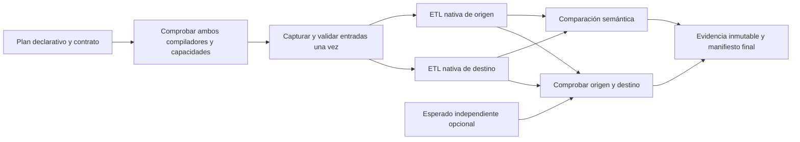

# Migración integrada de planes ETL y comprobación semántica

EquiFrame incorporará un migrador dentro de la biblioteca antes del paso 11,
conforme a la petición de Hernán. Este plan se registra antes de integrar el
runner. El migrador recibe una representación declarativa de una transformación,
la compila para dos motores, ejecuta ambas implementaciones nativas sobre una
captura común y compara sus salidas. Una referencia independiente opcional
permite comprobar cada motor, incluso cuando ambos comparten un error.

## Alcance y separación de responsabilidades

La universalidad se aborda mediante puertos y una representación intermedia
versionada, no prometiendo traducir cualquier programa Python o SQL. La primera
versión cubre una intersección explícita de Pandas, Polars y DuckDB. Nuevos
compiladores y adaptadores se registran desde código confiable. Los documentos
JSON no contienen plugins, callbacks, SQL libre, nombres de módulos ni credenciales.

La API sigue siendo independiente de SERCOP, del cliente de José y del DW de
Jhair. DuckDB usa una conexión propia en memoria. No hay publicación automática
del DW ni conversión de una única salida para aparentar dos ejecuciones.

## Representación y compiladores

El IR 1.0 es un DAG frozen y estricto, con referencias hacia nodos anteriores,
salida declarada, sin nodos huérfanos y presupuestos de nodos, profundidad y
columnas. Contiene Scan, Project, Filter, Cast exacto, EquiJoin inner/left,
Aggregate y Sort. Expresiones cerradas: columna, literal tipado, comparaciones,
booleanos de tres estados, negación, IS NULL e IS NaN.

NULL y NaN permanecen distintos. Joins declaran claves incompletas iguales o sin
coincidencia; agrupaciones declaran retener/descartar grupos ausentes y suma
vacía nula/cero. Decimal tiene precisión máxima 38 en la intersección inicial.
Sumas enteras/decimales comprueban overflow, no lo silencian. Cast solo admite
identidad y ensanchamiento exacto. Orden declara dirección, ausencias y empates.
Float permite transporte y predicados; claves, agrupación, orden y agregación
float quedan fuera de esta versión. Timestamps y funciones temporales están
fuera del IR inicial, aunque la ejecución general existente los admite.

`PlanCompiler.check` informa soporte sin ejecutar ETL. `compile` entrega una
Transformation nativa, identidad determinista y huellas de IR/contrato.
`CompilerRegistry` es propiedad del consumidor; no hay registro global mutable.
Pandas opera DataFrames, Polars expresiones/frames y DuckDB un SELECT/WITH cerrado
con identificadores y literales escapados. Operaciones no fieles se rechazan
antes de ejecutar cualquiera de los motores.

## Runner y evidencia

1. Validar configuración, IR y contrato; comprobar los dos compiladores,
   dependencias y capacidades antes de leer la fuente.
2. Resolver cada entrada una sola vez, aislar buffers del consumidor, comprobar
   esquema físico exacto y restricciones de valores, conservar índice y
   procedencia, y publicar capturas propias verificables.
3. Ejecutar dos pipelines nativos independientes con las capturas fijadas.
   R, perfil y M/B/H reutilizan la orquestación existente; entrenamiento no ocurre
   durante migración y el bundle se suministra por separado.
4. Comparar origen/destino y, si se suministra, cada uno contra el mismo esperado
   fijado previamente. El esperado no entra en perfiles ni detectores.
5. Publicar reportes, eventos, hijos e inventario; `migration.json` se publica
   al final. Un fallo de publicación conserva evidencia parcial sin simular
   finalización.
6. Leer/validar un bundle sin ejecutar motores: hashes, inventario cerrado,
   eventos, configuraciones, hijos, comparaciones y reportes deben coincidir.

Se separan finalización técnica, diferencias, alertas, comprobación independiente
y componentes no evaluables. Dos salidas iguales solo demuestran equivalencia
observada bajo el contrato; no prueban corrección independiente.

El índice Pandas no se descarta implícitamente. La comparación predeterminada
lo rechaza; autorizar ignorarlo exige una política y justificación explícitas.
La captura rechaza un índice significativo mientras el IR no pueda representarlo
como columnas. No se convierten tipos incorrectos de entrada para hacerlos pasar.

Un presupuesto total comprende captura y checkpoints de ambos pipelines y
comparaciones; se registran las opciones efectivas de cada hijo. Timeout y
cancelación son cooperativos, con interrupción de consulta DuckDB donde la API
existente la ofrece. Los límites de buffers son controles tras materialización,
no cuotas duras de RSS ni un sandbox para proveedores/plugins.

## Entrega y aceptación previstas

API: `MigrationSpec`, `MigrationRequest`, `MigrationResult`, `migrate`,
`read_migration`, `migration_summary`, IR, compiladores y sus puertos.
CLI: `equiframe migration validate/run/verify`; JSON Schema para los nuevos
documentos, sin cambiar formatos 1.0 anteriores. Códigos de run: 0 completo sin
alertas/diferencias, 1 completo con alertas/diferencias, 2 entrada/preflight
inválidos, 3 fallo o no evaluable. Verify acredita integridad, no corrección.

La aceptación requiere las tres parejas y ambas direcciones técnicamente
admitidas, esperados independientes, errores compartidos, captura única,
aislamiento, preflight sin ETL, NULL/NaN, montos exactos, multiplicidad, vacío,
overflow, cancelación, límites, evidencia alterada, CLI, imports base ligeros,
tipos estrictos, wheel y sdist comprobados fuera del checkout. Estos son criterios
del plan, no resultados anticipados. Las pruebas locales se ejecutarán sin
habilitar GitHub Actions. Publicación PyPI y evidencia científica siguen pendientes.

## Extensión posterior 0.11.0

Este documento conserva el diseño/evidencia del migrador inicial. La ampliación
actual tiene [diseño ETL](ETL_DESIGN.md), [diseño Verify](VERIFY_DESIGN.md),
[matriz trazable](SEMANTIC_SUPPORT.md) y [revisión actual](VERIFY_ETL_REVIEW_20261003.md).
No reutiliza los resultados históricos como validación del código nuevo.
