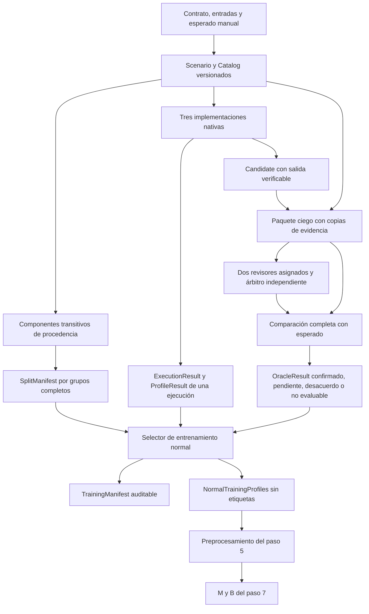

# Arquitectura del paso 6 y reorientación después de los pasos 1 a 5

Versión 0.6, 2026-10-01. El paso 6 construye la frontera experimental de
EquiFrame: catálogo trazable, oráculo independiente con revisión, grupos de
procedencia y selección de entrenamiento normal. La biblioteca operacional
permanece en `equiframe 0.5.0`; el componente nuevo es `equiframe-benchmark 0.6.0`.
La evaluación científica y la publicación pública siguen pendientes.

## Fundamento en la tesis

Se contrastó `TFM_EquiFrame_ACTUAL.docx`, SHA-256
`c96f0edfcab839b2ccf357527f4a7937c4b1fd3570f491d702b4f01fde44b38d`,
especialmente §1.3, §3.3.4, §3.4, §3.6 y §3.7. El borrador no se modifica.
Su objetivo general es evaluar reglas combinadas con Isolation Forest para
detectar divergencias de migraciones ETL entre Pandas, Polars y DuckDB,
con preparación reproducible de datos SERCOP–OCDS.

| Objetivo específico del borrador | Aporte concreto del paso 6 | Límite |
|---|---|---|
| OE1: caracterizar cinco familias mediante requisitos y casos revisables | Cinco escenarios, esperados manuales, controles y fallos específicos | Catálogo técnico sintético; revisión humana pendiente |
| OE2: snapshot, tres ETL comparables y DW reconciliado | Entradas verificadas idénticas y quince ejecuciones nativas | No sustituye snapshot SERCOP, DW de Jhair ni servicio de José |
| OE3: biblioteca con reglas, perfiles, IF, MAD y evidencia | Paquetes separados; integración de capturas/perfiles con selección comprobada | IF/MAD/H corresponden al paso 7 |
| OE4: comparar métodos contra resultados revisados independientemente | Oráculo sin detectores; asignaciones, desacuerdos y particiones por grupos | No presenta exactitud ni ventaja de H |
| Objetivo adicional de documentación y reproducción | Manifiestos, esquemas, hashes, pruebas, wheel/sdist y piloto externo | Repetición científica por otro integrante pendiente |

## Qué se conserva y qué se reorienta

| Base existente | Riesgo al continuar sin ajuste | Reorientación implementada |
|---|---|---|
| Paso 1: contratos y librería instalable | Mezclar etiquetas experimentales con API general | `equiframe` nunca depende del benchmark |
| Paso 2: ejecución nativa y artefactos | Vincular un perfil a una salida de otra ejecución | Enlazar contrato, entradas, salida, implementación, ejecución y perfil |
| Paso 3: comparación completa | Llamar oráculo a la coincidencia entre motores | Comparar contra esperado independiente; exigir dos revisiones antes de etiquetar |
| Paso 4: catálogo y R versionados | Generar mutantes y ajustar R después | Publicar catálogo y huella real de R antes de crear candidatos |
| Paso 5: perfiles y `NormalTrainingProfiles` | Aceptar normalidad por declaración o entrenar con prueba | Selector externo exige O confirmado normal y grupo de entrenamiento |
| Metas 60 escenarios / 300 perfiles | Aumentar cifras con semillas y variantes dependientes | Reportar escenarios, ejecuciones y grupos por separado |
| Reparto nominal 30/10/20 | Romper dependencias para alcanzar cuotas | Particionar componentes completos; registrar desbalance y familias ausentes |
| Revisión con tres autores | El árbitro puede ser autor de la variante | Rechazar conflictos también en arbitraje; mantener el caso pendiente |
| Producto `pip install equiframe` | Confundir un checkout instalable con disponibilidad en PyPI | Verificar wheel por nombre con pip y mantener pendiente la publicación pública |

La selección de columnas del piloto es técnica, no la configuración experimental
definitiva. El piloto usa R mínima de esquema con huella de código/opciones;
no reemplaza ni altera el catálogo del paso 4. Antes de variantes finales deberán
seleccionarse y congelarse las reglas y features justificadas por familia.

## Componentes y dependencias

| Módulo de `equiframe_benchmark` | Responsabilidad |
|---|---|
| `models` | Documentos estrictos, inmutables y revalidados; referencias con SHA-256/tamaño |
| `oracle` | Paquetes ciegos, validación de autores/revisores, comparación y decisión O |
| `splits` | Cierre transitivo, asignación determinista y auditoría de fuga |
| `selection`, `training_types` | Elegibilidad y manifiesto de entrenamiento con trazabilidad completa |
| `io` | JSON sin claves repetidas/coerciones/NaN; publicación atómica sin sobrescribir |
| `fixtures`, `mutations`, `pilot` | Cinco familias sintéticas, quince ETL nativos y candidatos de ensayo |

El benchmark depende de `equiframe[arrow]`. El extra `engines` instala los tres
motores para el piloto. Ambos imports son ligeros. No hay dependencia del DW,
OCI, scikit-learn o paquetes de compañeros. Los documentos nuevos tienen
`schema_version=1.0`; los formatos previos permanecen intactos.

## Oráculo y revisión independiente

`Scenario` identifica contrato/política, tablas de entrada, esperado, método de
obtención, autores, revisión de transformación, dependencias y huellas de R/features.
`Candidate` conserva procedencia y tipo control/mutación únicamente en el lado
del coordinador. Ninguna alerta sirve de etiqueta.

`review_packet` copia artefactos verificando bytes, bajo un token aleatorio y
nombres `input-N`, `expected`, `output`. El revisor recibe entradas, contrato,
salida candidata y esperado; no recibe clase de mutación, motor, autores,
alertas ni revisión ajena. Los nombres originales de archivos no se propagan.
El coordinador debe comprobar pistas incidentales en contenido/contrato y
entregar exclusivamente el directorio del paquete a cada revisor.

`ReviewAssignment` registra dos personas y un árbitro distintos, ninguno autor
del escenario, esperado o candidato. La fecha de asignación precede las revisiones;
la resolución sigue a ambas. Cada `Review` exige identidad canónica, UTC,
justificación, hash del paquete y declaración de revisión ciega. Identidades y
fechas declaradas **no constituyen autenticación ni firma**; el procedimiento
humano debe conservar evidencia externa y controlar alias de una misma persona.

| Situación | Estado / etiqueta |
|---|---|
| Menos de dos revisiones | `pending`, sin etiqueta |
| Revisores discrepan sin resolución | `disagreement`, sin etiqueta |
| Revisiones coinciden con comparación completa | `confirmed`, normal o divergente |
| Revisiones contradicen el esperado/comparador | `disagreement`, sin etiqueta; corregir en nueva revisión |
| Comparación falla o revisión concluye evidencia insuficiente | `not_evaluable`, sin etiqueta |
| Autor intenta revisar/arbitrar, paquete obsoleto, entrada corrupta | Error explícito; no generar aprobación |

El efecto `no_effect` significa que la comparación no detectó diferencia respecto
del esperado para esa entrada y contrato. No demuestra que el operador de mutación
sea siempre inocuo. El registro completo incluye comparación y evidencia de diferencias.
La comparación sigue limitada a `output_schema`; la revisión debe comprobar que
el esperado y el contrato representan correctamente la operación.

## Procedencia y particiones

Las dependencias declaradas usan tokens estables de plantilla, transformación,
caso base, fragmento u OCID. Además se unen automáticamente escenarios que
comparten bytes de entradas o esperado, aunque se haya omitido el token.
El productor sigue siendo responsable de declarar relaciones que no son
deducibles de hashes, por ejemplo fragmentos distintos del mismo OCID.
Igualdad de bytes es un criterio conservador: puede reducir el soporte.

Primero se calcula el cierre transitivo. Se ordenan grupos mediante SHA-256 de
semilla e identidad de miembros; después se asigna cada grupo a la partición
con menor cociente exacto entre escenarios asignados y peso deseado. Empates:
training, calibration, test. No se usan etiquetas ni scores. La auditoría
recalcula cobertura, componentes, huellas y algoritmo completo.
El orden del catálogo no altera asignaciones; el hash del documento sí conserva
su representación. No se garantiza equilibrio por familia ni todas las
particiones con pocos grupos. Esas ausencias deben condicionar el paso 7.

## Frontera de entrenamiento

`select_normal_training` recibe mapas por **ID de candidato**, permitiendo varios
motores/ejecuciones del mismo escenario sin contarlos como grupos nuevos.
Rechaza conjuntos vacíos/incompletos, prueba/calibración, O pendiente/divergente,
versiones distintas, autores en revisión, perfiles ajenos, entradas/salida
incompatibles, artefactos alterados y duplicación de evidencia.

Entrega `TrainingSelection(manifest, training)`. El manifiesto enlaza catálogo,
splits, grupo, candidato, O, perfil y ejecución. Solo `selection.training` se
pasa a `ef.fit_preprocessor`; la matriz no contiene etiquetas, motor o IDs.
La procedencia se valida contra registros de productores confiables: el software
no autentica al autor ni vuelve a calcular cada estadística firmada por un hash.
La selección no certifica variación, independencia suficiente o modelo estimable.

## Piloto y aceptación técnica

Cinco escenarios, quince ejecuciones nativas y perfiles, veinte controles
(tres motores más permutación por familia), quince mutaciones de artefactos
(eliminar fila, identidad sin efecto y fallo semántico por familia):
**35 candidatos en total**. Las mutaciones de artefactos prueban O; no se
presentan como código ETL mutado ni producen perfiles de una ejecución inexistente.

Los fallos específicos son NULL monetario convertido en cero, pérdida de
izquierda sin pareja, eliminación por clave repetida, intercambio de totales
entre almacenes conservando suma global y desplazamiento de fecha. Esperados
enumerados manualmente y esquemas físicos explícitos no se calculan con Pandas.

El piloto se detiene si un motor, perfil o comparación falla. Persiste catálogo
antes de candidatos y resumen solo al completar el recorrido. Mantiene todos los
casos sin aprobación. Los tests usan identidades ficticias marcadas como tales;
esas decisiones no se exportan como revisiones científicas.

## Distribución Python y siguientes entregas

`equiframe` ya es una distribución Python con `src`, `pyproject.toml`, API,
extras, CLI y `py.typed`. Este paso conserva ese nombre y agrega la distribución
experimental separada. Se construyen wheel/sdist y se verifica `pip install`
por nombre desde los wheels locales, import desde otro directorio, pruebas
contra el wheel y reconstrucción idéntica desde sdist.

El destino público solicitado es `python -m pip install equiframe`. Para
cumplirlo desde el índice público faltan licencia acordada, control/disponibilidad
del nombre, configuración de publicación y prueba contra la versión publicada.
La consulta del nombre durante esta tarea no dio una respuesta verificable;
no se afirma que esté disponible o reservado. Se sigue el proceso de
[empaquetado de PyPA](https://packaging.python.org/en/latest/tutorials/packaging-projects/).
Publicar código en Git no publica automáticamente el paquete en PyPI.

Paso 7: implementar IF/MAD/H y estados no estimables; ampliar procedencias
independientes y obtener revisiones antes de entrenar. Paso 8: integrar CLI,
reportes, reducción y orquestación. Paso 9: consumir entregas reales de José/Jhair.
Paso 10: resolver políticas de dominio, licencia, alpha y soporte; congelar el
experimento, evaluar sin reajustar con prueba, publicar y repetir externamente.

La ingeniería del paso 6 puede cerrarse con revisiones humanas pendientes,
conforme a la hoja de ruta. El cierre científico requiere esas revisiones y
soporte real; no lo acredita el piloto sintético.
