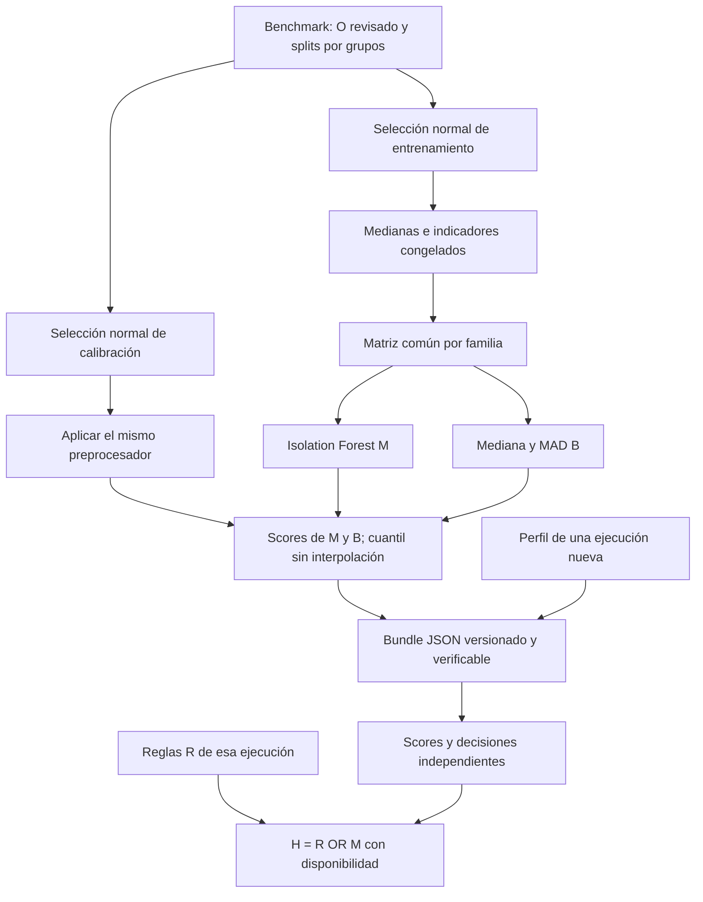

# Paso 7 Arquitectura de detectores y reorientación

Versión 0.7, 2026-10-01. Fuente: `TFM_EquiFrame_ACTUAL.docx`, §1.3,
§3.4.3 y §3.6–3.7; SHA-256
`c96f0edfcab839b2ccf357527f4a7937c4b1fd3570f491d702b4f01fde44b38d`.
El documento fuente se conserva sin modificaciones. Este diseño distingue
requisitos del borrador, decisiones de ingeniería y pendientes experimentales.

## Propósito y relación con los objetivos

El objetivo general es evaluar el aporte de combinar comprobaciones e Isolation
Forest para detectar divergencias de migraciones ETL entre Pandas, Polars y
DuckDB, sobre datos SERCOP–OCDS reproducibles. El paso 7 implementa los componentes
que permitirán esa comparación; sus pruebas no demuestran las hipótesis H1–H3.

| Objetivo específico de §1.3 | Aporte y límite del paso 7 |
|---|---|
| OE1 Describir y comprobar cinco familias | Un ajuste por `ProfileSpec`, con orden, fórmulas y familia ligados por hash; no modifica R ni el esperado |
| OE2 Snapshot, tres ETL y DW reproducibles | Consume perfiles de ejecuciones existentes; no construye el DW ni el servicio de José |
| OE3 Biblioteca con R, perfiles, IF, MAD y estados | Implementa M/B, calibración externa, persistencia declarativa y H; reportes integrados quedan en 8 |
| OE4 Comparación independiente de detección, falsas alarmas, cobertura y costo | Conserva scores, n, umbral, decisiones y disponibilidad; métricas/costos científicos se ejecutarán en 10 |
| Documentación y reproducción (quinto párrafo específico) | Configuración, semillas, hashes, versiones, ejemplos instalados y restauración verificable |

## Reorientación después de los pasos 1 a 6

| Evidencia existente | Ajuste necesario | Consecuencia |
|---|---|---|
| Contratos, tres motores nativos, comparación exacta y R funcionan | Mantener las fronteras; coincidencia de motores no demuestra corrección | O continúa en el benchmark y no entra en M/B |
| Perfiles y medianas congeladas en 0.5.0 | Reutilizar una sola matriz con indicadores para ambos métodos | Sin preprocesadores divergentes ni selección de features con prueba |
| Selección normal del paso 6 solo cubre entrenamiento | Añadir selección normal de calibración con las mismas comprobaciones de procedencia | Rechazar prueba, etiquetas pendientes, capturas ajenas y grupos cruzados |
| Piloto: 5 escenarios, 4 grupos, 15 perfiles, 35 revisiones pendientes | No convertir ejecuciones/semillas en grupos independientes | No hay modelo científico entrenable con el piloto actual |
| No existe justificación final de alpha o soporte por familia | Parámetros de soporte y alpha explícitos; registrar n y límites | Un mínimo técnico no garantiza una tasa poblacional de falsas alarmas |
| Paquete local instalable; PyPI pendiente | Añadir extra ML, wheel/sdist y consumidor externo que instala por nombre | `pip install equiframe` público requiere licencia, control del nombre y publicación verificable |
| OCI/SERCOP aún dependen del equipo | Completar ingeniería local sin inventar integración | Pasos 9–10 conservan sus condiciones de entrada |

No se amplía el catálogo científico automáticamente ni se asignan revisiones
ficticias al piloto. Los tests pueden fabricar revisiones únicamente como fixtures
de software. Antes del experimento hay que ampliar grupos por familia, revisar
normalidad, justificar alpha y congelar protocolo/variables/corpus.

## Componentes y flujo

Las flechas de selección trasladan solamente `ProfileVector` y un hash de
manifiesto; no trasladan etiquetas, IDs, mutaciones, motor ni partición al vector.
La auditoría de grupos reside en `equiframe_benchmark`. La biblioteca general no
certifica la declaración de normalidad de un consumidor externo.

API prevista e implementada en esta entrega: `fit_detectors`,
`score_detectors`, `calibrate_detectors`, `detect`, `combine_decisions`,
`write_detector_bundle` y `read_detector_bundle`. Entrenar, calibrar e inferir son
acciones distintas. Cada resultado conserva las huellas de ajuste/matriz/bundle.
La calibración produce un bundle nuevo sin mutar el ajuste.

## Contrato estadístico

- M se ajusta mediante scikit-learn con semilla explícita, 200 árboles y hasta
  256 muestras como configuración inicial revisable; no usa `predict`,
  `decision_function` ni el umbral de `contamination`.
- M puntúa como `-score_samples`; mayor score significa mayor anomalía.
  Su transporte numérico float32 se declara y verifica, incluida pérdida de
  variación o valores fuera de rango. B utiliza la misma matriz original en
  precisión Python; no se altera la matriz común para encubrir conversiones.
- B conserva mediana y MAD sin factor de escala por columna de la matriz.
  MAD cero aporta cero si coincide la mediana y `+infinity` en otro caso.
  El máximo de contribuciones es el score. Infinito es una etiqueta JSON,
  nunca NaN ni un número JSON inválido.
- Sin suficientes filas, sin variables o sin variación se informa
  `not_estimable`. El mínimo técnico por ajuste/calibración es explícito;
  el benchmark audita además grupos distintos con mínimos explícitos.
- Alpha se expresa como cadena decimal entre 0 y 1 y es obligatorio. Se calcula
  exactamente `k = ceil((1-alpha)*n)` con aritmética racional, posiciones desde
  uno, y `tau = sorted(scores)[k-1]`. No se interpola. `score == tau` no alerta.
- Calibración vacía/insuficiente no produce ausencia de alerta. Umbral infinito
  deja B no estimable. Scores infinitos frente a un umbral finito sí alertan.
- H alerta si cualquiera alerta; solo no alerta si ambos no alertan y están
  completos. Un componente no evaluable conserva la incompletitud de H. B no
  interviene en H. Se verifican las nueve combinaciones, además de R parcial.

## Persistencia y compatibilidad

El ajuste de sklearn se exporta como árboles declarativos: hijos, variable,
umbral y cantidad de muestras por nodo. Un evaluador de formato fijo recorre
esos datos, sin reconstruir objetos Python ejecutables. Se comprueban topología,
dimensiones, conteos, versiones y huellas. No se usa pickle/joblib ni carga de
plugins. El formato registra la fórmula de longitud de camino, conversión
float32, parámetros y versiones del productor; pruebas comparan sus scores
contra `IsolationForest.score_samples` de la dependencia bloqueada.

JSON de tamaño acotado, publicación sin sobrescritura, checksum externo opcional,
validación al leer y límites de árboles/nodos. Los hashes comprueban integridad,
no autoría. Los modelos son datos locales privados; no se versionan ajustes
reales. El import base no carga NumPy/sklearn ni los motores. El extra `ml`
habilita el entrenamiento; inferencia declarativa y MAD usan la biblioteca base.

## Entrega y aceptación

Núcleo y benchmark avanzan a 0.7.0; formatos previos conservan significado.
Se añaden esquemas 1.0 independientes. Se verifica estilo, formato, tipado,
esquemas, regresiones de ambos paquetes, wheel/sdist reproducible y consumo
externo base/ML/motores. CI ejecuta los mismos controles en cinco plataformas.

Los casos incluyen cuantiles exactos y empates, MAD cero/infinito, datos
constantes/vacíos, matrices incompatibles, calibración sin reajuste, selección
sin fuga, árboles corruptos, restauración y decisiones parciales. Los resultados
efectivos y límites se registran en `STEP_07_REVIEW.md` después de ejecutarlos.

## Referencias técnicas

- [IsolationForest, API oficial](https://scikit-learn.org/stable/modules/generated/sklearn.ensemble.IsolationForest.html).
- [Persistencia de modelos, documentación oficial](https://scikit-learn.org/stable/model_persistence.html).
- [Distribución de paquetes Python](https://packaging.python.org/en/latest/tutorials/packaging-projects/).

Estas fuentes apoyan decisiones de ingeniería; las fórmulas y objetivos se
contrastaron con el borrador local. No sustituyen evidencia experimental.
