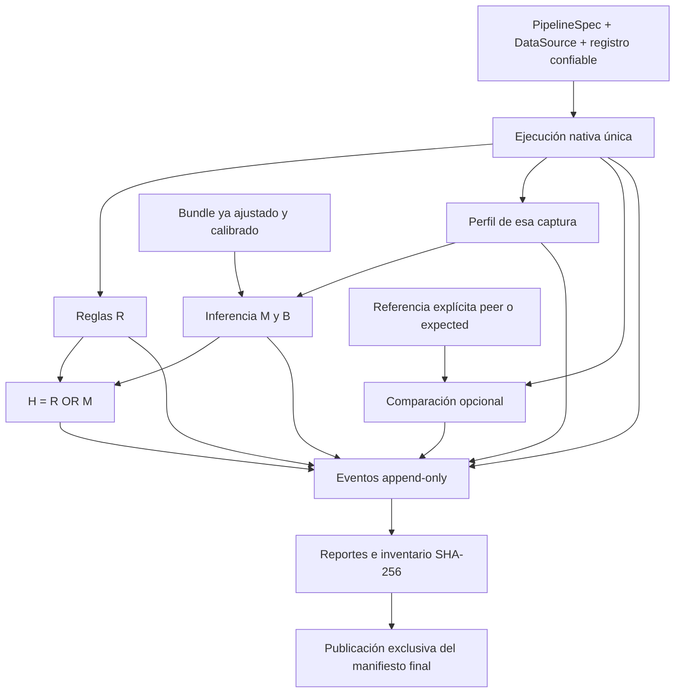

# Paso 8: orquestación, evidencia y reducción

Fecha: 2026-10-01. Versión de ingeniería: núcleo/benchmark 0.8.0.

## Propósito y decisiones de alcance

Los pasos 1–7 proporcionan componentes independientes. Este paso hace posible
ejecutarlos como una operación trazable desde Python, notebooks y automatización.
La complejidad añadida se concentra en estados, procedencia, recuperación de
evidencia y pruebas de fallos; conserva las fórmulas, el oráculo y las particiones.
No modifica el DOCX ni implementa la VM de José o el DW de Jhair.

No hay una flecha desde la comparación o una etiqueta hacia M/B. El runner no
entrena, calibra, cambia alpha ni aplica selección experimental. Una referencia
`expected` identifica el lado declarado por el consumidor; no aporta revisión
humana, ni crea automáticamente una etiqueta O.

## Contrato de ejecución

`PipelineSpec` fija contrato/transformación/motor, opciones R, perfil y política
de comparación. La API recibe explícitamente fuente, registro, adaptador opcional,
registro R opcional, bundle y referencia. Cada llamada obtiene un UUID y conserva
su carpeta; no hay estado global ni reintento de callbacks.

Las etapas son execution, rules, profile, detection, comparison e hybrid. Cada
una tiene estado terminal, duración y código. La ausencia de un componente
solicitado produce incompletitud. Los fallos de perfil/detector no impiden comparar
una captura disponible. H conserva alertas parciales sin convertir la ausencia de
M en `no_alert`; B no participa en H.

`complete` significa que terminaron todas las evaluaciones solicitadas. Una
corrida con R y sin modelos puede estar completa, pero H queda expresamente no
evaluable. Solicitar modelos exige un perfil explícito y exige ambos M/B para
completar la corrida. Una alerta o una diferencia completa no es un fallo técnico.

Los formatos nuevos son `1.0`, separados de la versión de producto. Se amplía
`DetectorVersions.equiframe` para aceptar 0.7.0 y 0.8.0; el algoritmo declarativo
continúa siendo `equiframe-if-mad-1.0`. Los bundles previos con versión explícita
0.7.0 siguen siendo válidos; no se reinterpretan sus valores.

## Evidencia y límites de confianza

Se publica `pipeline.json` antes de ejecutar. `events.jsonl` contiene números
consecutivos y enlaces SHA-256 sobre JSON canónico; cada append se sincroniza.
La carpeta incluye entorno acotado, capturas, resultados de componentes, bundle
si fue solicitado, reportes y manifiesto final. Este último se publica por enlace
duro exclusivo después de inventariar los bytes. Nunca se reemplaza una corrida.

El lector comprueba ruta relativa, contención, tamaños, hashes, cadena de eventos,
resultados de componentes, configuración, identidad del bundle y contenido de los
reportes. Una carpeta sin manifiesto final es interrumpida aunque tenga eventos
que anuncien el fin del cálculo. Se puede inspeccionar, pero no declara éxito.

Estos hashes detectan corrupción respecto del manifiesto recibido; no son una
firma digital ni un almacenamiento WORM. Un actor que pueda reemplazar todos los
archivos puede recalcular hashes. Los controles son locales y de un escritor por
corrida. Una avería de disco puede impedir registrar el propio fallo; en ese caso
la API eleva el error y el manifiesto final no se publica.

Eventos y reportes usan campos seleccionados: no registran entorno completo,
argv, nombres de usuario, SQL, parámetros, filas o texto de excepciones. El
runner rechaza nombres comunes de parámetros de autenticación: las credenciales
pertenecen al proveedor inyectado. Las capturas y manifiestos técnicos completos
son privados: conservan datos y parámetros ETL para reproducibilidad. No se
promete reconocer secretos arbitrarios escondidos en esos datos o en código
confiable. El HTML escapa todo texto y no carga JavaScript ni recursos remotos.

## Reducción acotada

`reduce_case` recibe tablas Arrow, predicado confiable, versión del predicado y
firma explícita del fallo. El predicado debe comprobar **todas** las precondiciones
relevantes y distinguir el fallo buscado de otros errores. El reducer no infiere
semántica de claves/joins ni ejecuta código desde JSON.

El algoritmo elimina complementos de bloques de posiciones originales entre
tablas, reduce granularidad después de un éxito y termina comprobando supresiones
de una fila. Conserva esquema, orden relativo y multiplicidad; no redondea,
reescribe valores o elimina columnas. Los intentos que rompen precondiciones,
cambian de fallo o no son evaluables se rechazan. Una excepción del predicado
detiene la búsqueda y conserva el último candidato aceptado.

Presupuesto de llamadas, tiempo cooperativo, filas de entrada y confirmaciones
son explícitos. Por defecto cada aceptación exige dos reproducciones; eso detecta
algunas inestabilidades, sin garantizar determinismo. Se comprueba cancelación y
tiempo después del callback: un éxito que llega tarde no se acepta. No hay
preempción de código bloqueante. La captura de archivos no es una cuota dura de
disco/memoria; el presupuesto temporal de búsqueda empieza después de capturar
las entradas originales.

`one_minimal` significa que, para el predicado determinista observado, ninguna
supresión individual adicional conserva precondiciones y fallo. No afirma tamaño
mínimo global, ni optimalidad sobre columnas/valores, ni todas las combinaciones
posibles. Si se agota el presupuesto, el estado es `budget_exhausted` y la
minimalidad queda `not_established`. Se guardan posiciones, observaciones, eventos,
tablas originales/reducidas e inventario de cada intento.

## Relación científica

La orquestación apoya OE3 y la reproducción de OE4/OE5. No amplía el corpus real,
no confirma revisores ni valida H1–H3. Los modelos de las pruebas son sintéticos
y temporales. El piloto mantiene sus cinco escenarios, cuatro grupos, quince
perfiles y 35 revisiones pendientes. La evaluación final, métricas, recursos
controlados y congelación científica permanecen en el paso 10.
